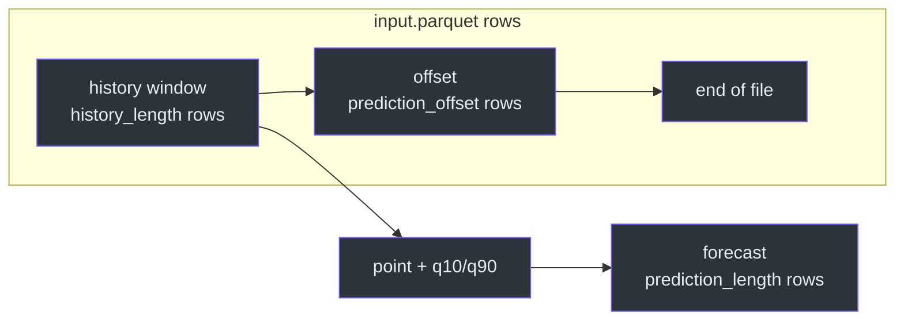
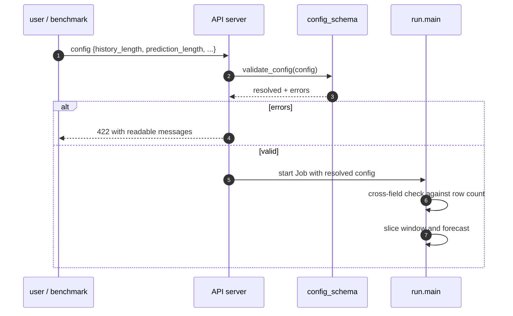
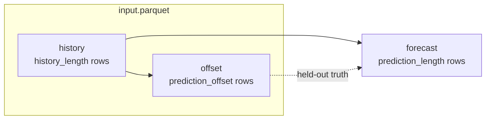

# Configuration

## Why the config is this small

The model has no hyperparameters to tune beyond the ones that define the
forecast question itself: *how much history*, *how far ahead*, *which statistic*.
Everything else is fixed by the null hypothesis. The card declares exactly four
keys, and `config_schema.py` refuses anything else
([`fdo.json:31-67`](https://github.com/The-EPISERVE-Consortium/model__prediction__generic__null-model/blob/main/fdo.json#L31-L67)).

| Key | Required | Type | Bounds | Default | Meaning |
|---|---|---|---|---|---|
| `history_length` | yes | integer | ≥ 3 | — | Rows in the window whose statistic is repeated |
| `prediction_length` | yes | integer | 1–512 | — | Steps to forecast |
| `prediction_offset` | no | integer | ≥ 0 | 0 | Rows skipped at the end (back-testing) |
| `statistic` | no | string | `mean`, `median`, `last` | `mean` | Which window statistic to repeat |

Source: [`fdo.json:35-61`](https://github.com/The-EPISERVE-Consortium/model__prediction__generic__null-model/blob/main/fdo.json#L35-L61).

## The window equation

The window is the slice `[len(data) - offset - history_length, len(data) - offset)`
([`src/run.py:121-125`](https://github.com/The-EPISERVE-Consortium/model__prediction__generic__null-model/blob/main/src/run.py#L121-L125)):



<!-- Sources: src/run.py:113-125, fdo.json:40 -->

Two constraints follow:

1. `history_length + prediction_offset ≤ len(input.parquet)`, otherwise the run
   fails with an `ERROR:` naming both numbers
   ([`src/run.py:113-119`](https://github.com/The-EPISERVE-Consortium/model__prediction__generic__null-model/blob/main/src/run.py#L113-L119)).
2. `history_length ≥ 3`: with fewer points the empirical q10/q90 are not
   meaningful ([`src/series.py:18-20`](https://github.com/The-EPISERVE-Consortium/model__prediction__generic__null-model/blob/main/src/series.py#L18-L20)).



<!-- Sources: src/config_schema.py:98-130, src/run.py:74-87, src/run.py:113-119 -->

The two-stage check is deliberate: the per-key schema runs before any data
exists (API server, `--check-config`), and the cross-field rule runs inside the
container where the row count is known
([`fdo.json:63-66`](https://github.com/The-EPISERVE-Consortium/model__prediction__generic__null-model/blob/main/fdo.json#L63-L66)).

## Back-testing with `prediction_offset`



<!-- Sources: src/run.py:121-125, fdo.json:49-55 -->

With `prediction_offset=8`, the model forecasts the 8 rows it skipped, so the
output can be compared directly with known values.

## `statistic` semantics

| Value | Code path | Result for window `[1089.8 … 128208.3]` |
|---|---|---|
| `mean` | `values.mean()` | 14,029.19 |
| `median` | `np.median(values)` | 2,953.07 |
| `last` | `values[-1]` | 4,267.20 |

Source: [`src/model.py:27-46`](https://github.com/The-EPISERVE-Consortium/model__prediction__generic__null-model/blob/main/src/model.py#L27-L46).
The q10/q90 are **not** affected by `statistic`; they are always the empirical
quantiles of the same window
([`src/model.py:92`](https://github.com/The-EPISERVE-Consortium/model__prediction__generic__null-model/blob/main/src/model.py#L92)).

## Defaults and unknown keys

Optional keys are filled from the card's `default` before the model sees them
([`src/config_schema.py:123-130`](https://github.com/The-EPISERVE-Consortium/model__prediction__generic__null-model/blob/main/src/config_schema.py#L123-L130)).
Unknown keys are rejected together, not one at a time:

```json
{"history_length": 34, "prediction_length": 8, "horizon": 8}
```

```text
ERROR: config.json has unrecognised key(s): 'horizon'
```

Source: [`src/config_schema.py:80-82`](https://github.com/The-EPISERVE-Consortium/model__prediction__generic__null-model/blob/main/src/config_schema.py#L80-L82).

## Error message catalogue

| Condition | Message shape | Source |
|---|---|---|
| Missing key | `config.json missing required key: '<name>'` | [`config_schema.py:77-79`](https://github.com/The-EPISERVE-Consortium/model__prediction__generic__null-model/blob/main/src/config_schema.py#L77-L79) |
| Wrong type | `config.json key '<k>' must be a <type>` | [`config_schema.py:85-87`](https://github.com/The-EPISERVE-Consortium/model__prediction__generic__null-model/blob/main/src/config_schema.py#L85-L87) |
| Below minimum | `config.json key '<k>' must be >= <n>` | [`config_schema.py:88-89`](https://github.com/The-EPISERVE-Consortium/model__prediction__generic__null-model/blob/main/src/config_schema.py#L88-L89) |
| Above maximum | `config.json key '<k>' must be <= <n>` | [`config_schema.py:90-91`](https://github.com/The-EPISERVE-Consortium/model__prediction__generic__null-model/blob/main/src/config_schema.py#L90-L91) |
| Bad enum | `config.json key '<k>' must be one of 'mean', 'median', 'last'` | [`config_schema.py:92-94`](https://github.com/The-EPISERVE-Consortium/model__prediction__generic__null-model/blob/main/src/config_schema.py#L92-L94) |
| Unknown key | `config.json has unrecognised key(s): 'x', 'y'` | [`config_schema.py:80-82`](https://github.com/The-EPISERVE-Consortium/model__prediction__generic__null-model/blob/main/src/config_schema.py#L80-L82) |
| Too little data | `not enough input data: ... has only N rows` | [`run.py:113-119`](https://github.com/The-EPISERVE-Consortium/model__prediction__generic__null-model/blob/main/src/run.py#L113-L119) |

## Worked examples

### Benchmark run (8-week horizon)

```json
{"history_length": 34, "prediction_length": 8, "prediction_offset": 0, "statistic": "mean"}
```

Uses the last 34 rows, writes 8 rows, all with the same point and interval.

### Back-test against known data

```json
{"history_length": 34, "prediction_length": 8, "prediction_offset": 8}
```

Skips the last 8 rows, forecasts them from the preceding 34, so the result can
be compared with the held-out truth
([`fdo.json:49-55`](https://github.com/The-EPISERVE-Consortium/model__prediction__generic__null-model/blob/main/fdo.json#L49-L55)).

### Minimum viable config

```json
{"history_length": 3, "prediction_length": 1}
```

`prediction_offset` defaults to 0 and `statistic` to `mean`.

## Related Pages

| Page | Why read it |
|---|---|
| [Container Contract](./container-contract.md) | Where the config file lives |
| [Model Card and Config Validation](../02-architecture/model-card-and-validation.md) | How the card becomes a validator |
| [The Null Forecast](../02-architecture/null-forecast.md) | What the statistic does to the output |

## References

- [`fdo.json:31-67`](https://github.com/The-EPISERVE-Consortium/model__prediction__generic__null-model/blob/main/fdo.json#L31-L67)
- [`src/config_schema.py`](https://github.com/The-EPISERVE-Consortium/model__prediction__generic__null-model/blob/main/src/config_schema.py)
- [`src/run.py:84-98`](https://github.com/The-EPISERVE-Consortium/model__prediction__generic__null-model/blob/main/src/run.py#L84-L98)
