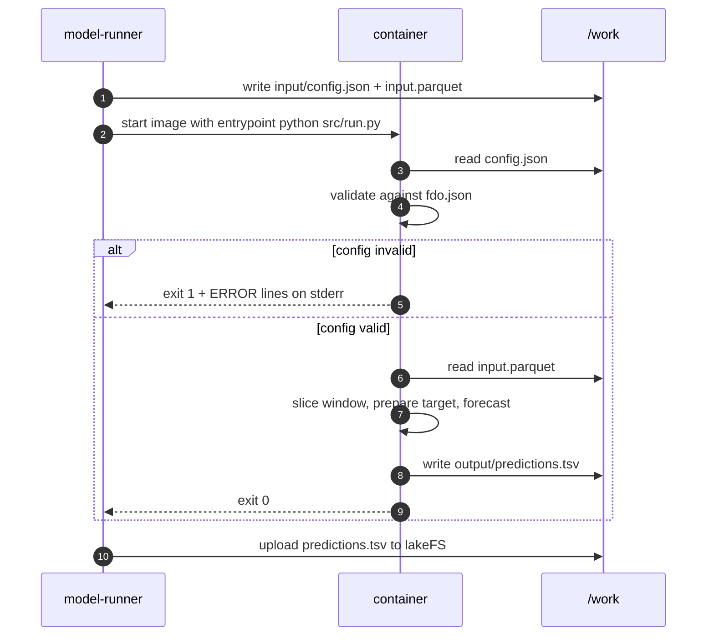
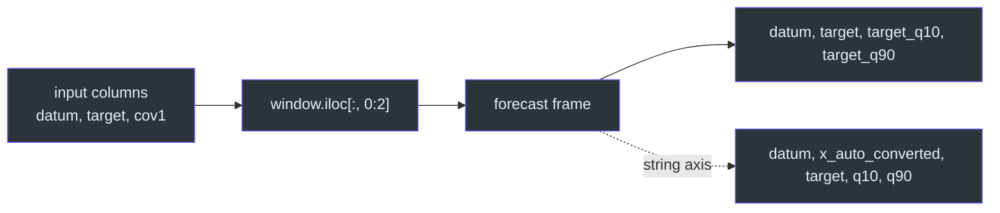
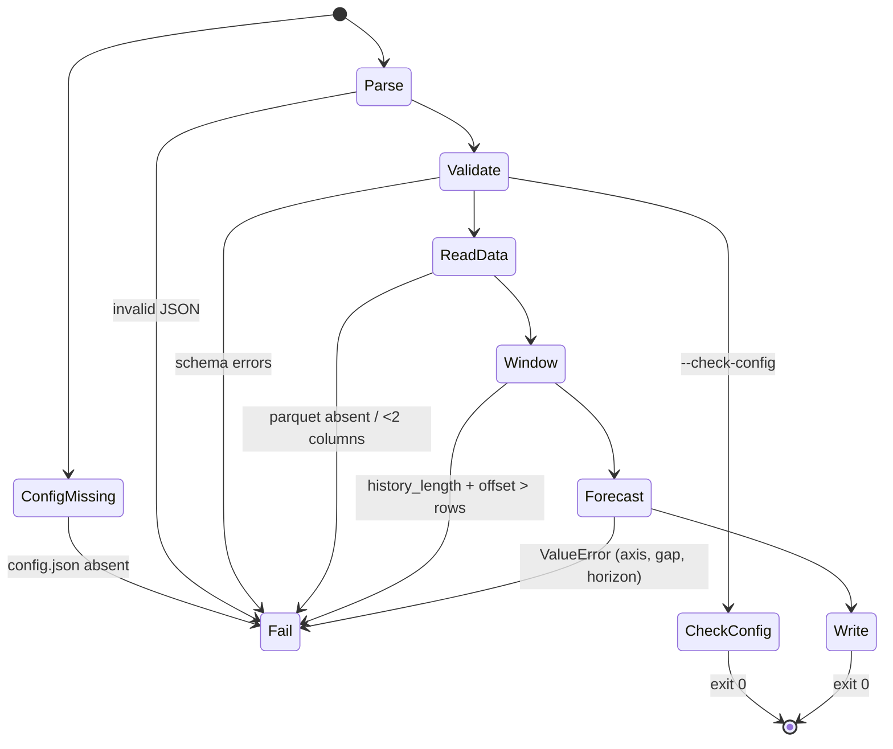
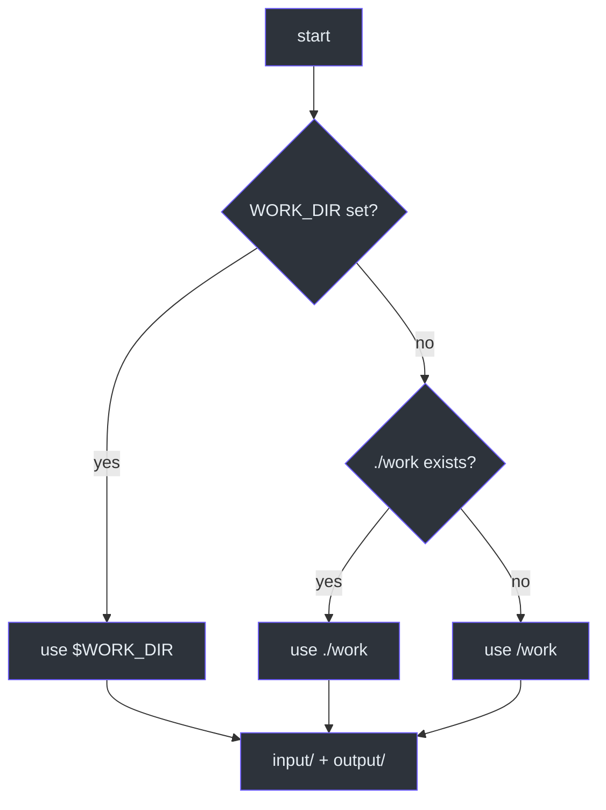

# Container Contract

## Why a contract instead of an API

The model-runner does not import this code. It starts a Kubernetes Job with a
shared `emptyDir` mounted at `/work`, puts two files in `/work/input`, and reads
one file from `/work/output` after the container exits
([`src/run.py:1-12`](https://github.com/The-EPISERVE-Consortium/model__prediction__generic__null-model/blob/main/src/run.py#L1-L12)).
That boundary is what lets the platform run Python, R or a compiled binary
without changing the runner. The price is that **everything the model needs must
be in those two input files**, and **everything the platform needs must be in
that one output file**.

| Path | Direction | Format | Required |
|---|---|---|---|
| `/work/input/config.json` | in | JSON object | yes |
| `/work/input/input.parquet` | in | Apache Parquet, ≥2 columns | yes, except `--check-config` |
| `/work/output/predictions.tsv` | out | TSV, one row per step | yes on success |

Source: [`src/run.py:61-67`](https://github.com/The-EPISERVE-Consortium/model__prediction__generic__null-model/blob/main/src/run.py#L61-L67),
[`src/run.py:100-104`](https://github.com/The-EPISERVE-Consortium/model__prediction__generic__null-model/blob/main/src/run.py#L100-L104),
[`src/run.py:143-145`](https://github.com/The-EPISERVE-Consortium/model__prediction__generic__null-model/blob/main/src/run.py#L143-L145).

## The run, as a sequence



<!-- Sources: src/run.py:47-148, src/run.py:143-145 -->

## Input details

### `config.json`

A flat JSON object. Unknown keys are **errors**, not warnings, because the card
sets `additionalProperties: false`
([`fdo.json:31-35`](https://github.com/The-EPISERVE-Consortium/model__prediction__generic__null-model/blob/main/fdo.json#L31-L35)).
The schema, bounds and defaults are documented in
[Configuration](./configuration.md).

### `input.parquet`

The model reads the file with pandas and uses **the first two columns only**
([`src/run.py:104-111`](https://github.com/The-EPISERVE-Consortium/model__prediction__generic__null-model/blob/main/src/run.py#L104-L111)):

| Position | Role | Accepted types | Notes |
|---|---|---|---|
| 0 | time axis | date, datetime, isoWeek, integer, number, string | unique, increasing, uniform step |
| 1 | target | number, nullable | gaps ≤8 interpolated, longer rejected |
| 2+ | ignored | any | covariates are not used |

The column names are free. The output reuses the input names, so a benchmark
target called `viruslast_normalisiert` produces `viruslast_normalisiert`,
`viruslast_normalisiert_q10`, `viruslast_normalisiert_q90`
([`src/model.py:103-113`](https://github.com/The-EPISERVE-Consortium/model__prediction__generic__null-model/blob/main/src/model.py#L103-L113)).

## Output details

`predictions.tsv` is tab-separated with a header row. For a datetime axis:

```text
datum	viruslast_normalisiert	viruslast_normalisiert_q10	viruslast_normalisiert_q90
2026-08-19	14029.1917	1468.8	39224.8
2026-08-26	14029.1917	1468.8	39224.8
...
```

For a string axis an extra `x_auto_converted` column carries the 1-indexed row
position, because the model cannot invent new labels
([`src/model.py:99-110`](https://github.com/The-EPISERVE-Consortium/model__prediction__generic__null-model/blob/main/src/model.py#L99-L110)).



<!-- Sources: src/run.py:123-125, src/model.py:99-114 -->

## Exit codes and error format

| Code | Meaning | What the runner sees |
|---|---|---|
| 0 | success, `predictions.tsv` written | run continues |
| 1 | any handled failure | stderr line(s) beginning `ERROR:` |

Every handled failure goes through `_fail`, which prints exactly one
`ERROR: <message>` line and returns 1
([`src/run.py:29-32`](https://github.com/The-EPISERVE-Consortium/model__prediction__generic__null-model/blob/main/src/run.py#L29-L32)).
Config validation may print several lines, one per problem, before returning
([`src/run.py:79-82`](https://github.com/The-EPISERVE-Consortium/model__prediction__generic__null-model/blob/main/src/run.py#L79-L82)).



<!-- Sources: src/run.py:65-146 -->

The `except Exception` at [`src/run.py:140-141`](https://github.com/The-EPISERVE-Consortium/model__prediction__generic__null-model/blob/main/src/run.py#L140-L141)
converts unexpected library errors into the same `ERROR:` format, so the runner
never has to parse a Python traceback.

## `--check-config` fast path

`python src/run.py --check-config` validates `config.json` against the card and
exits **before reading any data or importing the forecast code**
([`src/run.py:96-98`](https://github.com/The-EPISERVE-Consortium/model__prediction__generic__null-model/blob/main/src/run.py#L96-L98)).
It prints `config.json OK` and returns 0, or the usual `ERROR:` lines and 1.

```bash
docker run --rm -v $(pwd)/work/input:/work/input \
  ghcr.io/the-episerve-consortium/model__prediction__generic__null-model:latest \
  --check-config
```

This is the cheapest way for the API server to reject a bad config before
scheduling a Job.

## Work-directory resolution



<!-- Sources: src/run.py:35-44 -->

In the container there is no `./work`, so the fallback is `/work`. Locally,
`WORK_DIR=./work` makes the same code run without root or a mount
([`src/run.py:41-44`](https://github.com/The-EPISERVE-Consortium/model__prediction__generic__null-model/blob/main/src/run.py#L41-L44)).

## Related Pages

| Page | Why read it |
|---|---|
| [Configuration](./configuration.md) | The keys validated before any data is read |
| [Local Development](./local-development.md) | Reproducing the contract without Kubernetes |
| [Execution Pipeline](../02-architecture/execution-pipeline.md) | What happens between the files |

## References

- [`src/run.py`](https://github.com/The-EPISERVE-Consortium/model__prediction__generic__null-model/blob/main/src/run.py)
- [`fdo.json:69-108`](https://github.com/The-EPISERVE-Consortium/model__prediction__generic__null-model/blob/main/fdo.json#L69-L108) — input/output declarations
- [`Dockerfile`](https://github.com/The-EPISERVE-Consortium/model__prediction__generic__null-model/blob/main/Dockerfile)
