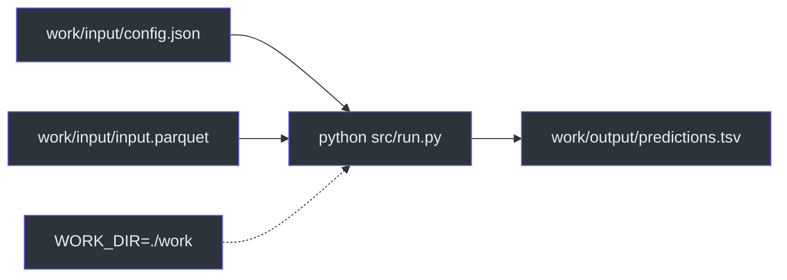
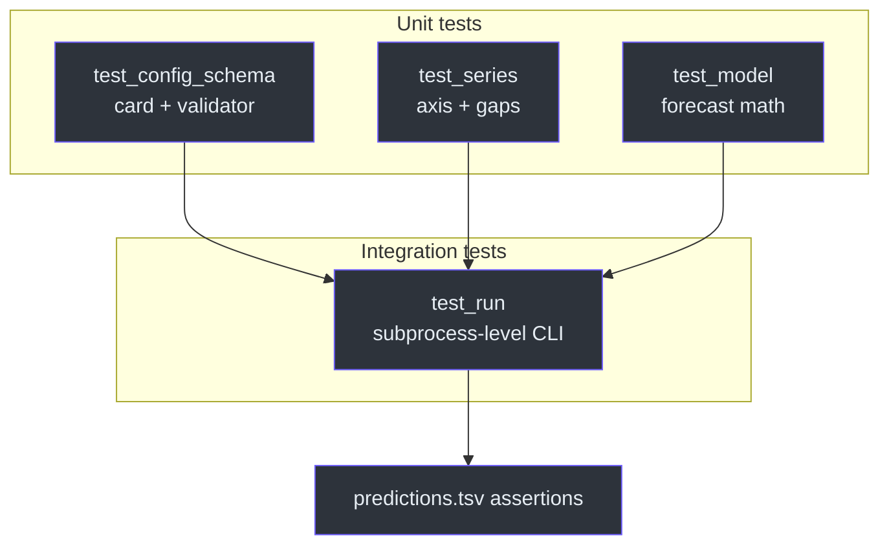
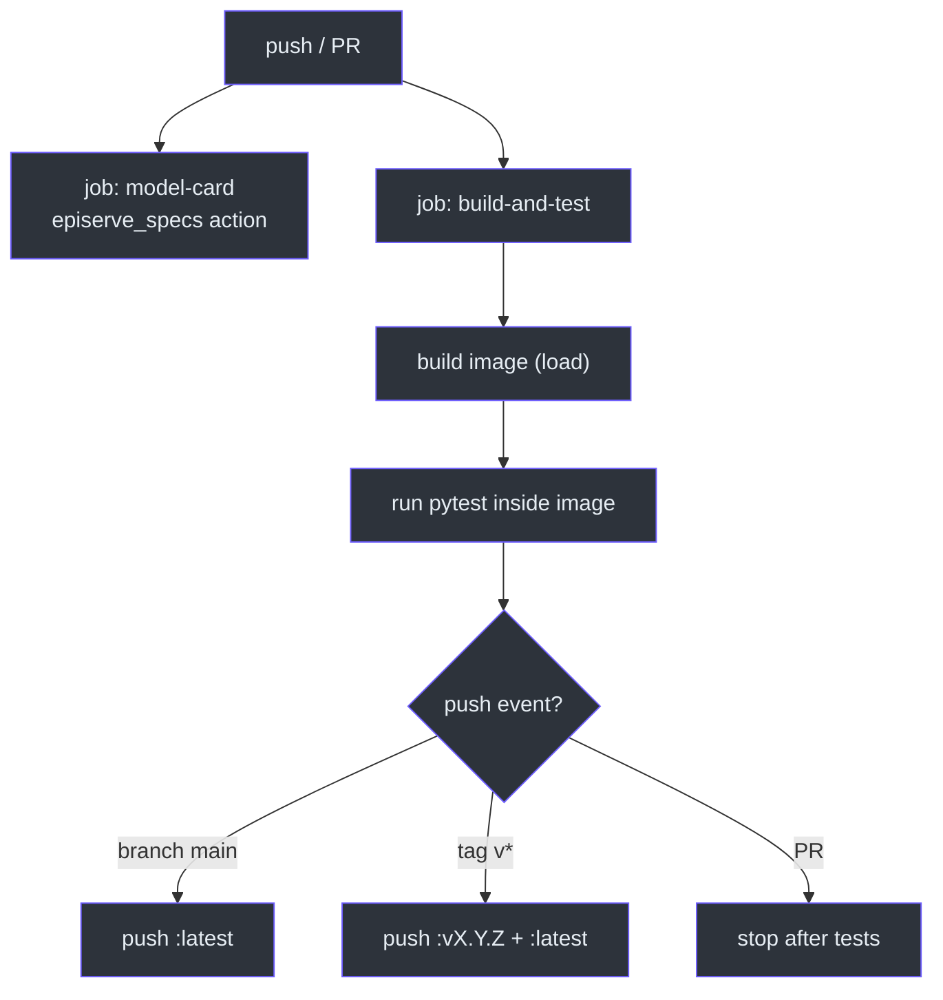

# Local Development

## The shortest feedback loop

The container contract is just a directory layout, so the fastest way to run the
model is to point `WORK_DIR` at a local folder
([`src/run.py:35-44`](https://github.com/The-EPISERVE-Consortium/model__prediction__generic__null-model/blob/main/src/run.py#L35-L44)):

```bash
python3 -m venv .venv && source .venv/bin/activate
pip install -r requirements.txt -r requirements-test.txt

mkdir -p work/input work/output
cat > work/input/config.json <<'JSON'
{"history_length": 34, "prediction_length": 8, "statistic": "mean"}
JSON
# copy or generate work/input/input.parquet (first two columns: time, target)

WORK_DIR=./work python src/run.py
column -t -s $'\t' work/output/predictions.tsv
```



<!-- Sources: src/run.py:35-44, src/run.py:61-67, src/run.py:143-145 -->

No `PYTHONPATH` is needed: `run.py` inserts its own directory into `sys.path`
([`src/run.py:22-26`](https://github.com/The-EPISERVE-Consortium/model__prediction__generic__null-model/blob/main/src/run.py#L22-L26)).

## Validate a config without data

```bash
WORK_DIR=./work python src/run.py --check-config
# Config: history_length=34, prediction_length=8, prediction_offset=0, statistic=mean
# config.json OK
```

This path returns before `input.parquet` is touched
([`src/run.py:96-98`](https://github.com/The-EPISERVE-Consortium/model__prediction__generic__null-model/blob/main/src/run.py#L96-L98)),
which makes it safe to run against an empty `work/input`.

## Tests

```bash
ruff check src tests
mypy src
pytest tests/ -v --cov=src --cov-report=term-missing   # 83 tests
pytest tests/test_model.py -v
pytest tests/test_run.py::test_predictions_are_written_with_the_expected_values -v
```

| File | What it locks down | Tests |
|---|---|---|
| `tests/test_config_schema.py` | Card/model agreement, defaults, error text | 27 |
| `tests/test_model.py` | Point statistics, quantiles, clamping, axis output | 19 |
| `tests/test_series.py` | Axis kinds, uniform step, DST, gap policy | 22 |
| `tests/test_run.py` | Full CLI: config, data errors, TSV output | 15 |

Source: [`tests/`](https://github.com/The-EPISERVE-Consortium/model__prediction__generic__null-model/tree/main/tests).



<!-- Sources: tests/test_config_schema.py, tests/test_series.py, tests/test_model.py, tests/test_run.py -->

A useful pattern in this repo: `test_run.py` invokes `main()` with a temporary
`WORK_DIR` and asserts on the written TSV, so the tests exercise the same code
path as the container
([`tests/test_run.py:153-170`](https://github.com/The-EPISERVE-Consortium/model__prediction__generic__null-model/blob/main/tests/test_run.py#L153-L170)).

## Build the image

```bash
docker build -t episerve/generic-null-model:dev .
docker run --rm \
  -v $(pwd)/work/input:/work/input \
  -v $(pwd)/work/output:/work/output \
  episerve/generic-null-model:dev
```

The image is `python:3.11-slim`, installs `requirements.txt`, copies the repo and
sets `ENTRYPOINT ["python", "src/run.py"]`
([`Dockerfile:1-10`](https://github.com/The-EPISERVE-Consortium/model__prediction__generic__null-model/blob/main/Dockerfile#L1-L10)).
There is no `CMD`, so extra arguments such as `--check-config` are appended to
the entrypoint.

## CI/CD



<!-- Sources: .github/workflows/publish.yml:17-83 -->

Two design choices stand out:

1. **The card job is separate.** An invalid `fdo.json` fails a visible check but
   does not block the image, so a documentation fix can ship independently
   ([`.github/workflows/publish.yml:18-24`](https://github.com/The-EPISERVE-Consortium/model__prediction__generic__null-model/blob/main/.github/workflows/publish.yml#L18-L24)).
2. **Tests run inside the built image**, not on the runner
   ([`.github/workflows/publish.yml:57-63`](https://github.com/The-EPISERVE-Consortium/model__prediction__generic__null-model/blob/main/.github/workflows/publish.yml#L57-L63)).
   That catches missing runtime dependencies that a host `pip install` would
   hide.

## Release checklist

| Step | Command | Result |
|---|---|---|
| 1. Checks + tests | `ruff check src tests && mypy src && pytest tests/ -v --cov=src` | 83 passed, coverage ≥ 95% |
| 2. Card | `episerve-validate fdo.json` | 0 errors |
| 3. Image | `docker build -t … .` | local image |
| 4. Publish | `git push origin main` | `:latest` on GHCR |
| 5. Version | `git tag v0.1.0 && git push origin v0.1.0` | `:v0.1.0` + `:latest` |

Source: [`README.md:120-127`](https://github.com/The-EPISERVE-Consortium/model__prediction__generic__null-model/blob/main/README.md#L120-L127),
[`.github/workflows/publish.yml:65-83`](https://github.com/The-EPISERVE-Consortium/model__prediction__generic__null-model/blob/main/.github/workflows/publish.yml#L65-L83).

## Common failures

| Symptom | Cause | Fix |
|---|---|---|
| `config.json not found` | `WORK_DIR` points at the wrong directory | check `_work_dir()` output |
| `input.parquet must have at least 2 columns` | covariates-only file | put time first, target second |
| `x values must have a uniform step` | irregular axis | resample before the run |
| `NaN gap longer than 8` | long missing run | fill or shorten the window |
| `history_length + prediction_offset > rows` | window larger than file | lower `history_length` |

Source: [`src/run.py:65-119`](https://github.com/The-EPISERVE-Consortium/model__prediction__generic__null-model/blob/main/src/run.py#L65-L119),
[`src/series.py:136-191`](https://github.com/The-EPISERVE-Consortium/model__prediction__generic__null-model/blob/main/src/series.py#L136-L191).

## Related Pages

| Page | Why read it |
|---|---|
| [Container Contract](./container-contract.md) | The files this page reproduces locally |
| [Execution Pipeline](../02-architecture/execution-pipeline.md) | What to read when a test fails |
| [Contributor Guide](../onboarding/contributor-guide.md) | The full onboarding path |

## References

- [`README.md:102-127`](https://github.com/The-EPISERVE-Consortium/model__prediction__generic__null-model/blob/main/README.md#L102-L127)
- [`Dockerfile`](https://github.com/The-EPISERVE-Consortium/model__prediction__generic__null-model/blob/main/Dockerfile)
- [`.github/workflows/publish.yml`](https://github.com/The-EPISERVE-Consortium/model__prediction__generic__null-model/blob/main/.github/workflows/publish.yml)
