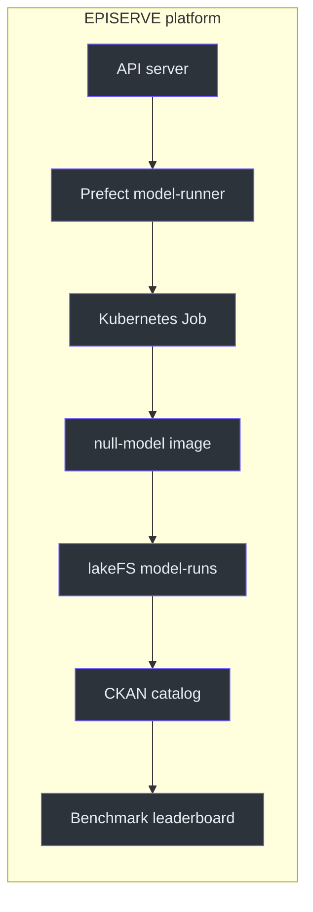
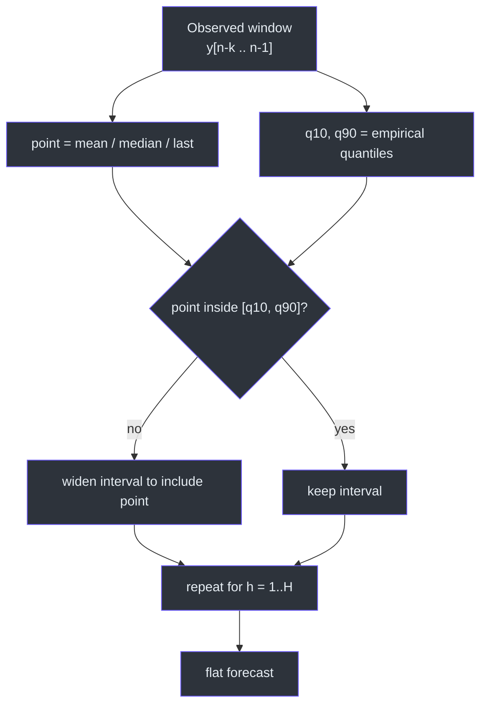
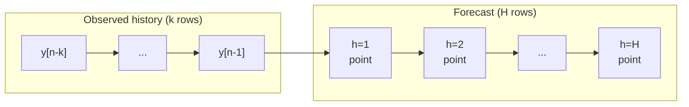

# Overview

## Why this model exists

Every forecast benchmark needs a floor. Without one, a leaderboard cannot answer
the first question a reader asks: *is this model actually better than doing
nothing?* The null model is that floor. It assumes the future looks like one
summary statistic of the recent past and nothing else — no trend, no seasonality,
no covariates ([`src/model.py:1-10`](https://github.com/The-EPISERVE-Consortium/model__prediction__generic__null-model/blob/main/src/model.py#L1-L10)).

It has a second job: because it is tiny and deterministic, it is the cheapest
possible end-to-end test of the model-runner pipeline. If a platform change
breaks image pull, config parsing, parquet reading or TSV output, this model
fails first and loudly ([`fdo.json:121`](https://github.com/The-EPISERVE-Consortium/model__prediction__generic__null-model/blob/main/fdo.json#L121)).

| Question | Answer | Source |
|---|---|---|
| What does it predict? | One statistic of the trailing window, repeated for every step | [`src/model.py:90`](https://github.com/The-EPISERVE-Consortium/model__prediction__generic__null-model/blob/main/src/model.py#L90) |
| Is the forecast flat? | Yes, by design: point and interval are identical in every row | [`src/model.py:106-114`](https://github.com/The-EPISERVE-Consortium/model__prediction__generic__null-model/blob/main/src/model.py#L106-L114) |
| Does it emit uncertainty? | Yes: empirical q10/q90 of the same window | [`src/model.py:92`](https://github.com/The-EPISERVE-Consortium/model__prediction__generic__null-model/blob/main/src/model.py#L92) |
| Does it train or download? | No: zero parameters, no network | [`fdo.json:111-117`](https://github.com/The-EPISERVE-Consortium/model__prediction__generic__null-model/blob/main/fdo.json#L111-L117) |
| What does it cost? | 250m CPU, 256Mi memory, ~5 s | [`fdo.json:112-116`](https://github.com/The-EPISERVE-Consortium/model__prediction__generic__null-model/blob/main/fdo.json#L112-L116) |

## Where it sits

<!-- Sources: fdo.json:8-16, .github/workflows/publish.yml:15, README.md:120-127 -->

The model itself only knows about `/work/input` and `/work/output`. Everything
else — pulling the input, pushing the predictions, registering the run — is the
runner's job ([`src/run.py:1-12`](https://github.com/The-EPISERVE-Consortium/model__prediction__generic__null-model/blob/main/src/run.py#L1-L12)).

## What "null" means here

<!-- Sources: src/model.py:89-97, src/model.py:106-114 -->

Three consequences follow directly from that definition:

1. **The output is constant.** If the window mean is 14,029.19, every forecast
   row is 14,029.19. Only the time axis advances
   ([`src/model.py:106-114`](https://github.com/The-EPISERVE-Consortium/model__prediction__generic__null-model/blob/main/src/model.py#L106-L114)).
2. **The interval is a spread, not a predictive distribution.** q10/q90 describe
   how variable the window was, not how uncertain the future is
   ([`src/model.py:7-9`](https://github.com/The-EPISERVE-Consortium/model__prediction__generic__null-model/blob/main/src/model.py#L7-L9)).
3. **It is a direct multi-step forecast.** Forecasts are never fed back into the
   window; a recursive (sliding-window) variant is deliberately not implemented
   ([`README.md:129-138`](https://github.com/The-EPISERVE-Consortium/model__prediction__generic__null-model/blob/main/README.md#L129-L138)).

## The forecast horizon

<!-- Sources: src/model.py:99-114 -->

The history is consumed once; the horizon is generated from it. Nothing in the
horizon feeds back into the history, which is what makes the line flat.

## Choosing the statistic

| Statistic | Forecast level | Best when | Weakness |
|---|---|---|---|
| `mean` | Average of the window | The window is stationary and not spiked | A single old spike drags the level up |
| `median` | Middle value | The window contains outbreaks or outliers | Ignores a genuine level shift |
| `last` | Final observation | Pure persistence is the right null | Ignores everything before the last point |

Source: [`src/model.py:27-46`](https://github.com/The-EPISERVE-Consortium/model__prediction__generic__null-model/blob/main/src/model.py#L27-L46),
[`fdo.json:56-61`](https://github.com/The-EPISERVE-Consortium/model__prediction__generic__null-model/blob/main/fdo.json#L56-L61).

On the AMELAG SARS-CoV-2 benchmark, the choice is dramatic: a 34-week `mean`
gives MAE 8,866 and full interval coverage, while a 50-week `median` gives the
same MAE but an interval score 4× worse, because the median level (15,641) sits
far below the mean-dominated interval. The statistic and the window length are
therefore tuned together, not independently.

## Non-goals

- Not a competitor to real forecasters; it should lose to them.
- Not a seasonal-naive or drift model — both would add trend/seasonality
  assumptions that the null hypothesis explicitly rejects.
- Not a recursive one-step-ahead forecaster (see
  [The Null Forecast](./../02-architecture/null-forecast.md)).
- Not a data-quality gate: it fills short gaps and rejects long ones, but it
  does not validate semantics ([`src/series.py:221-257`](https://github.com/The-EPISERVE-Consortium/model__prediction__generic__null-model/blob/main/src/series.py#L221-L257)).

## Related Pages

| Page | Why read it |
|---|---|
| [Container Contract](./container-contract.md) | The exact `/work` files and exit codes |
| [Configuration](./configuration.md) | How `history_length` and `statistic` change the level |
| [The Null Forecast](../02-architecture/null-forecast.md) | The arithmetic behind the flat line |
| [Execution Pipeline](../02-architecture/execution-pipeline.md) | How a run moves from config to TSV |

## References

- [`README.md`](https://github.com/The-EPISERVE-Consortium/model__prediction__generic__null-model/blob/main/README.md)
- [`fdo.json`](https://github.com/The-EPISERVE-Consortium/model__prediction__generic__null-model/blob/main/fdo.json)
- [`src/model.py`](https://github.com/The-EPISERVE-Consortium/model__prediction__generic__null-model/blob/main/src/model.py)
