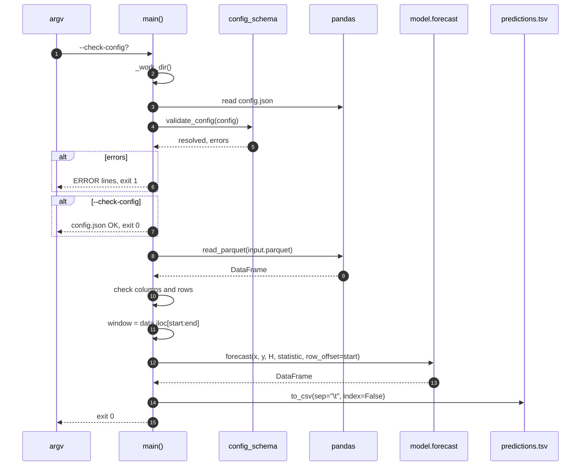
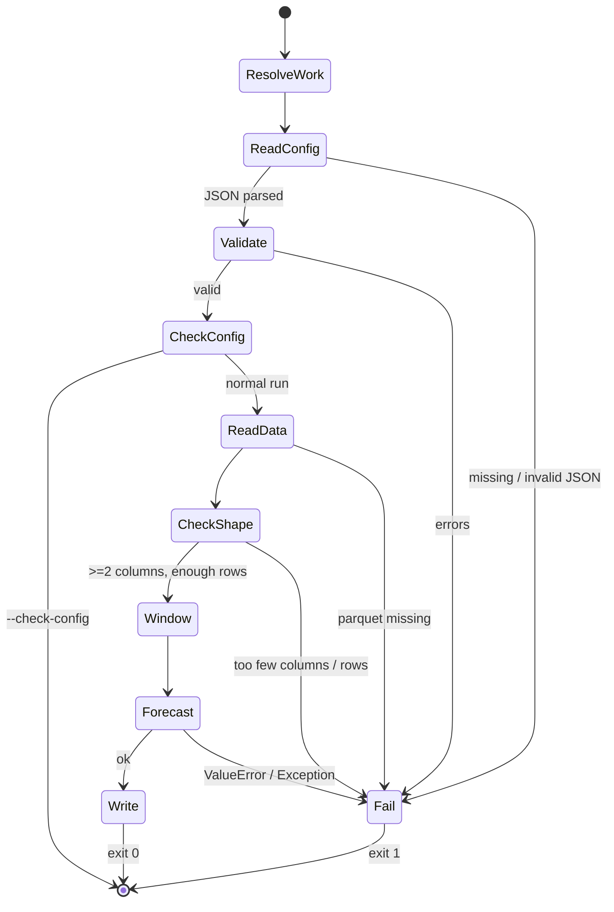
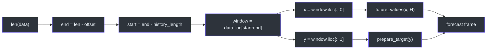
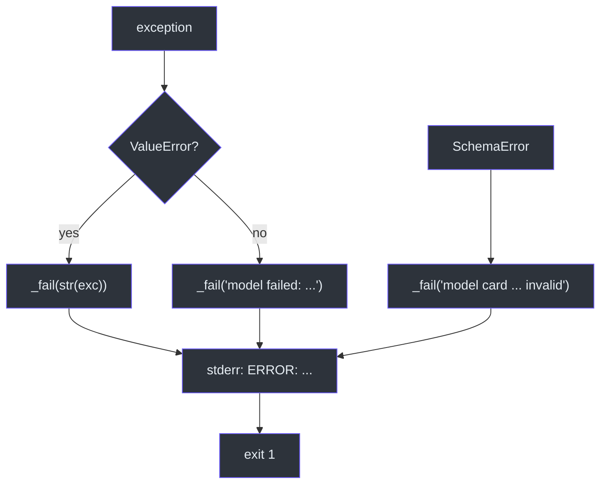
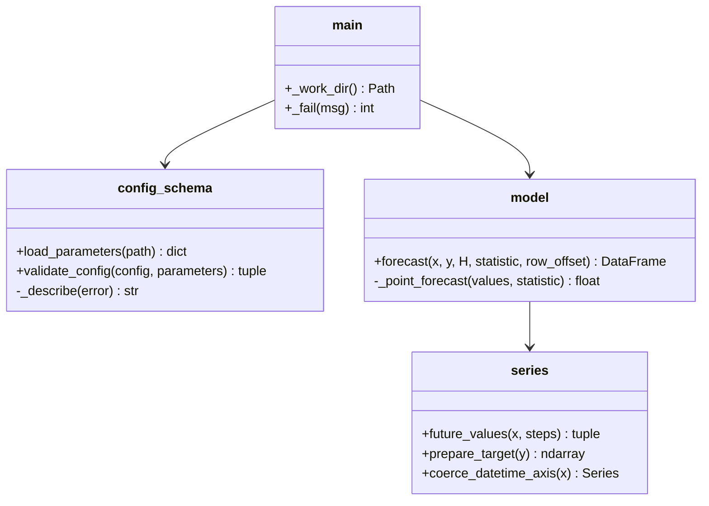

# Execution Pipeline

## Why the pipeline is one function

`main()` is intentionally a straight line of about 100 statements: parse
arguments, resolve the work directory, read and validate config, read and check
data, slice the window, forecast, write. There is no framework, no plugin
registry and no dependency injection. For a model whose entire job is one
arithmetic operation, indirection would cost more than it saves
([`src/run.py:47-148`](https://github.com/The-EPISERVE-Consortium/model__prediction__generic__null-model/blob/main/src/run.py#L47-L148)).

| Stage | Lines | Failure mode | Exit |
|---|---|---|---|
| Parse args | 53–59 | argparse error | 2 (argparse) |
| Resolve work dir | 61–63 | none | — |
| Read config | 65–72 | missing / invalid JSON | 1 |
| Validate config | 74–82 | schema errors / bad card | 1 |
| Print resolved config | 84–94 | none | — |
| `--check-config` | 96–98 | none | 0 |
| Read parquet | 100–105 | missing file / parse error | 1 |
| Column count | 107–111 | fewer than 2 | 1 |
| Row count | 113–119 | window exceeds file | 1 |
| Slice window | 121–125 | none | — |
| Forecast | 130–141 | `ValueError` / unexpected | 1 |
| Write TSV | 143–147 | I/O error | uncaught |

Source: [`src/run.py:47-148`](https://github.com/The-EPISERVE-Consortium/model__prediction__generic__null-model/blob/main/src/run.py#L47-L148).

## Sequence

<!-- Sources: src/run.py:53-148 -->

## State machine

<!-- Sources: src/run.py:61-148 -->

## The window slice

<!-- Sources: src/run.py:121-137, src/model.py:89-99 -->

`row_offset=start` is passed only so a string axis can report absolute row
positions; for datetime and numeric axes it is ignored
([`src/run.py:131-137`](https://github.com/The-EPISERVE-Consortium/model__prediction__generic__null-model/blob/main/src/run.py#L131-L137),
[`src/model.py:99-101`](https://github.com/The-EPISERVE-Consortium/model__prediction__generic__null-model/blob/main/src/model.py#L99-L101)).

## Failure handling

<!-- Sources: src/run.py:69-82, src/run.py:130-141 -->

The broad `except Exception` at the end is a deliberate contract choice: the
runner should receive an `ERROR:` line, not a traceback it cannot parse. The
comment says so explicitly
([`src/run.py:140-141`](https://github.com/The-EPISERVE-Consortium/model__prediction__generic__null-model/blob/main/src/run.py#L140-L141)).

## Class view

<!-- Sources: src/run.py:25-26, src/model.py:15, src/config_schema.py:38-134 -->

## Why this order

- **Config before data.** A bad config should fail in milliseconds, before a
  multi-gigabyte parquet file is read.
- **Column count before row count.** The error that explains the *shape* of the
  input is more useful than a window-size error caused by the same file.
- **Cross-field rule after loading.** `history_length + offset ≤ rows` cannot be
  checked without the row count, which is why it lives in `run.py` rather than in
  the JSON Schema ([`fdo.json:63-66`](https://github.com/The-EPISERVE-Consortium/model__prediction__generic__null-model/blob/main/fdo.json#L63-L66)).
- **Forecast before output directory creation.** `output/` is only created after
  a successful forecast, so a failed run does not leave an empty directory that
  could be mistaken for success ([`src/run.py:143`](https://github.com/The-EPISERVE-Consortium/model__prediction__generic__null-model/blob/main/src/run.py#L143)).

## Related Pages

| Page | Why read it |
|---|---|
| [Container Contract](../01-getting-started/container-contract.md) | The external view of this pipeline |
| [Time Axis and Target Handling](./series-handling.md) | What happens inside the forecast call |
| [The Null Forecast](./null-forecast.md) | The arithmetic at the centre |
| [Model Card and Config Validation](./model-card-and-validation.md) | The first two stages in depth |

## References

- [`src/run.py`](https://github.com/The-EPISERVE-Consortium/model__prediction__generic__null-model/blob/main/src/run.py)
- [`src/model.py`](https://github.com/The-EPISERVE-Consortium/model__prediction__generic__null-model/blob/main/src/model.py)
