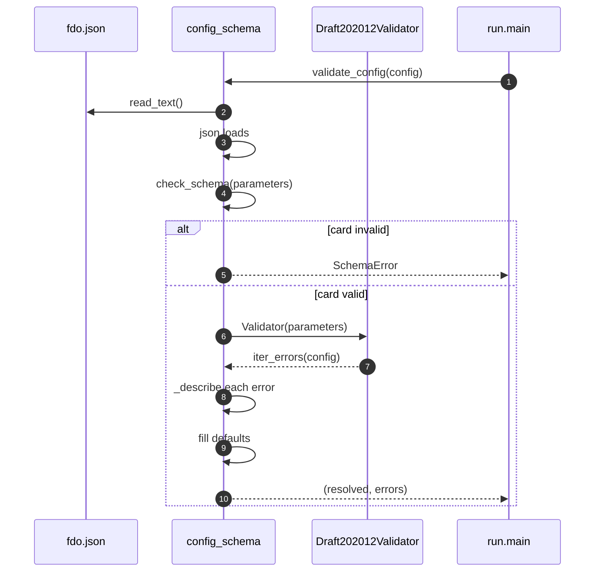
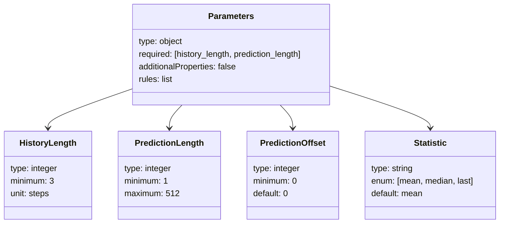
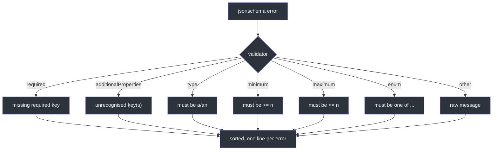
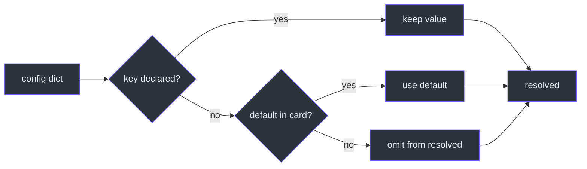
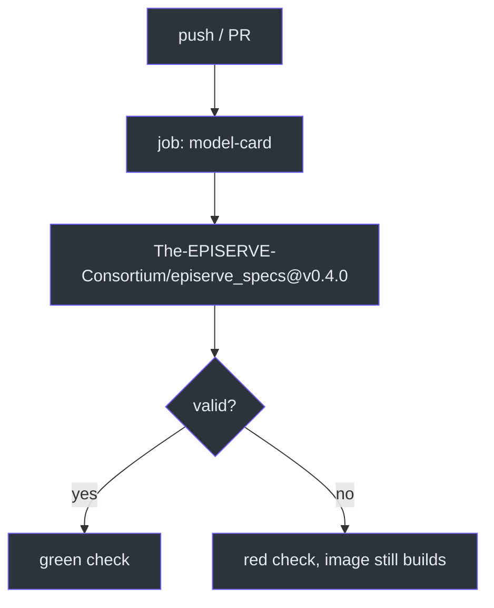

# Model Card and Config Validation

## Why the card is the source of truth

The platform needs to know three things before it can run a model: what
parameters it accepts, what files it reads, and what it writes. In EPISERVE those
are declared once in `fdo.json`, the **model card**, which follows the
[model-card v1 spec](https://github.com/The-EPISERVE-Consortium/episerve_specs/blob/main/src/episerve_specs/specs/model_card/README.md)
([`fdo.json:1-7`](https://github.com/The-EPISERVE-Consortium/model__prediction__generic__null-model/blob/main/fdo.json#L1-L7)).

The card is not documentation that happens to be machine-readable; it is the
input to the validator. `config_schema.py` loads `episerve:parameters` from the
card and hands it to `jsonschema`
([`src/config_schema.py:38-68`](https://github.com/The-EPISERVE-Consortium/model__prediction__generic__null-model/blob/main/src/config_schema.py#L38-L68)).
Changing a bound in the card changes what the API server accepts, what
`--check-config` accepts, and what the tests assert — without touching Python
logic.

| Card section | Consumer | Source |
|---|---|---|
| `episerve:task` | API server, benchmark workflow | [`fdo.json:18-29`](https://github.com/The-EPISERVE-Consortium/model__prediction__generic__null-model/blob/main/fdo.json#L18-L29) |
| `episerve:parameters` | `config_schema.validate_config` | [`fdo.json:31-67`](https://github.com/The-EPISERVE-Consortium/model__prediction__generic__null-model/blob/main/fdo.json#L31-L67) |
| `episerve:inputs` | runner preflight | [`fdo.json:69-92`](https://github.com/The-EPISERVE-Consortium/model__prediction__generic__null-model/blob/main/fdo.json#L69-L92) |
| `episerve:outputs` | runner postflight, scoring | [`fdo.json:94-109`](https://github.com/The-EPISERVE-Consortium/model__prediction__generic__null-model/blob/main/fdo.json#L94-L109) |
| `episerve:resources` | Kubernetes Job spec | [`fdo.json:111-117`](https://github.com/The-EPISERVE-Consortium/model__prediction__generic__null-model/blob/main/fdo.json#L111-L117) |
| `episerve:documentation` | catalog / model page | [`fdo.json:119-127`](https://github.com/The-EPISERVE-Consortium/model__prediction__generic__null-model/blob/main/fdo.json#L119-L127) |

## Validation flow



<!-- Sources: src/config_schema.py:38-130 -->

The two error classes are deliberately distinct:

| Exception | Meaning | Who fixes it |
|---|---|---|
| `SchemaError` | The card is missing, not JSON, or not a valid JSON Schema | Maintainer |
| validation errors | The user's `config.json` is wrong | Caller |

`run.py` reports them differently: a card problem says *"model card (fdo.json)
parameters are invalid"*, a config problem prints each user-facing message
([`src/run.py:74-82`](https://github.com/The-EPISERVE-Consortium/model__prediction__generic__null-model/blob/main/src/run.py#L74-L82)).

## The parameter schema



<!-- Sources: fdo.json:31-67 -->

Two details are worth calling out:

- **`additionalProperties: false`** makes unknown keys an error. This is why a
  typo such as `history_lenght` fails loudly instead of silently using the
  default ([`fdo.json:34`](https://github.com/The-EPISERVE-Consortium/model__prediction__generic__null-model/blob/main/fdo.json#L34)).
- **`rules`** is not JSON Schema; it is a list of human-readable cross-field
  constraints that `run.py` enforces after loading data
  ([`fdo.json:63-66`](https://github.com/The-EPISERVE-Consortium/model__prediction__generic__null-model/blob/main/fdo.json#L63-L66)).

## How errors become readable

`_describe` maps `jsonschema` error objects to one-line messages keyed by the
offending parameter
([`src/config_schema.py:71-95`](https://github.com/The-EPISERVE-Consortium/model__prediction__generic__null-model/blob/main/src/config_schema.py#L71-L95)):



<!-- Sources: src/config_schema.py:71-95 -->

Errors are sorted by path so that two runs with the same bad config produce the
same output order
([`src/config_schema.py:117-121`](https://github.com/The-EPISERVE-Consortium/model__prediction__generic__null-model/blob/main/src/config_schema.py#L117-L121)).
That is what makes the CLI output testable.

## Defaults



<!-- Sources: src/config_schema.py:123-130 -->

`resolved` always contains every declared key that has a value or a default. For
this card, a minimal `{"history_length": 3, "prediction_length": 1}` resolves to
all four keys, with `prediction_offset=0` and `statistic="mean"`
([`tests/test_config_schema.py:65-74`](https://github.com/The-EPISERVE-Consortium/model__prediction__generic__null-model/blob/main/tests/test_config_schema.py#L65-L74)).

## Card validation in CI



<!-- Sources: .github/workflows/publish.yml:18-24 -->

The card job is independent of `build-and-test`, so an invalid card is visible
but does not block a code fix from shipping
([`.github/workflows/publish.yml:18-21`](https://github.com/The-EPISERVE-Consortium/model__prediction__generic__null-model/blob/main/.github/workflows/publish.yml#L18-L21)).
Locally:

```bash
pip install "git+https://github.com/The-EPISERVE-Consortium/episerve_specs@v0.4.0"
episerve-validate fdo.json
```

## Parameter roles

`episerve:task.parameterRoles` tells the benchmark workflow which parameters to
prefill from the dataset split
([`fdo.json:24-28`](https://github.com/The-EPISERVE-Consortium/model__prediction__generic__null-model/blob/main/fdo.json#L24-L28)):

| Role | Parameter | Used for |
|---|---|---|
| `horizon` | `prediction_length` | test-window length |
| `history` | `history_length` | history window |
| `offset` | `prediction_offset` | back-test gap |

Without this mapping the workflow would have to special-case every model's
parameter names.

## Related Pages

| Page | Why read it |
|---|---|
| [Configuration](../01-getting-started/configuration.md) | The user-facing view of these keys |
| [Execution Pipeline](./execution-pipeline.md) | Where validation sits in the run |
| [Local Development](../01-getting-started/local-development.md) | Running `episerve-validate` |

## References

- [`fdo.json`](https://github.com/The-EPISERVE-Consortium/model__prediction__generic__null-model/blob/main/fdo.json)
- [`src/config_schema.py`](https://github.com/The-EPISERVE-Consortium/model__prediction__generic__null-model/blob/main/src/config_schema.py)
- [EPISERVE model-card v1 spec](https://github.com/The-EPISERVE-Consortium/episerve_specs/blob/main/src/episerve_specs/specs/model_card/README.md)
