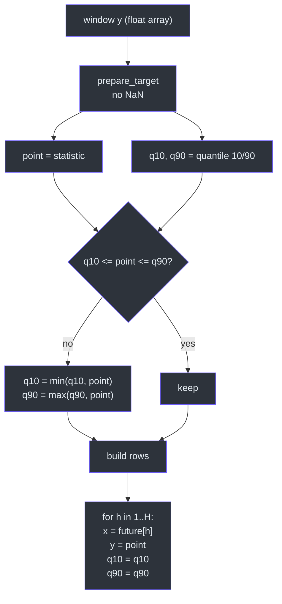
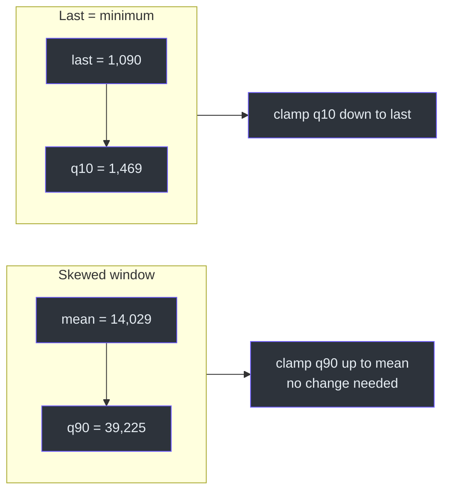
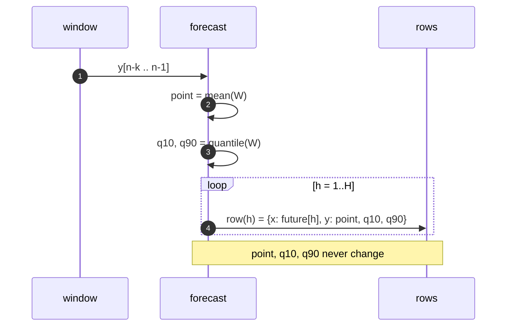
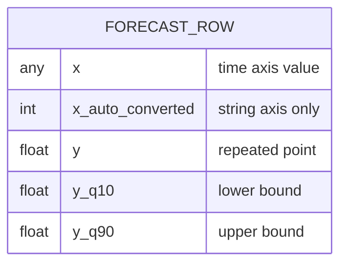

# The Null Forecast

## The hypothesis

The null model asserts: *the future is distributed like one summary statistic of
the recent past*. Concretely, for a window `W = y[n-k … n-1]` and horizon `H`:

```text
point_h = statistic(W)          for every h = 1 … H
q10_h   = quantile(W, 0.1)      for every h
q90_h   = quantile(W, 0.9)      for every h
```

There is no `h` on the right-hand side. That is the whole model
([`src/model.py:49-114`](https://github.com/The-EPISERVE-Consortium/model__prediction__generic__null-model/blob/main/src/model.py#L49-L114)).

| Quantity | Formula | Source |
|---|---|---|
| Point | `mean(W)` / `median(W)` / `W[-1]` | [`model.py:27-46`](https://github.com/The-EPISERVE-Consortium/model__prediction__generic__null-model/blob/main/src/model.py#L27-L46) |
| Interval | `np.quantile(W, [0.1, 0.9])` | [`model.py:92`](https://github.com/The-EPISERVE-Consortium/model__prediction__generic__null-model/blob/main/src/model.py#L92) |
| Clamp | `q10 = min(q10, point)`, `q90 = max(q90, point)` | [`model.py:96-97`](https://github.com/The-EPISERVE-Consortium/model__prediction__generic__null-model/blob/main/src/model.py#L96-L97) |
| Repetition | one row per `h`, same values | [`model.py:106-114`](https://github.com/The-EPISERVE-Consortium/model__prediction__generic__null-model/blob/main/src/model.py#L106-L114) |

## Flow



<!-- Sources: src/model.py:89-114 -->

## Why the clamp is necessary

The mean and the 10th/90th percentile are computed on the same window, but they
are not ordered by construction. A window with one very large spike has a mean
above its 90th percentile; a `last` value that is the minimum of the window is
below its 10th percentile. In both cases the point would lie outside its own
interval, which is incoherent for a forecast
([`src/model.py:93-97`](https://github.com/The-EPISERVE-Consortium/model__prediction__generic__null-model/blob/main/src/model.py#L93-L97)).



<!-- Sources: src/model.py:92-97 -->

The rule is minimal: only the violating bound moves, and only as far as the
point. The interval never narrows.

## Why the output is flat



<!-- Sources: src/model.py:99-114 -->

This is a **direct multi-step** forecast: the statistic is computed once from
observed history and never updated with its own predictions. A recursive variant
would append each forecast to the window and recompute; it is deliberately absent
([`README.md:129-138`](https://github.com/The-EPISERVE-Consortium/model__prediction__generic__null-model/blob/main/README.md#L129-L138)).

### Direct vs recursive, concretely

For `k=2`, a recursive mean would produce
`f_h = y_n - (y_n - y_{n-1}) / 2^h`: the last difference is halved at every step,
so the path converges to `y_n` rather than following a trend. On AMELAG, at the
same 34-week window the recursive mean is clearly worse (MAE 13,340 vs 8,866 for
the flat mean). With a 2-week window it is marginally better than the flat
2-week mean (14,960 vs 15,222), but both are far from the 34-week flat result.
The flat model is simpler and, at the window that matters here, more accurate.

| Variant | h=1 | h=2 | h=3 | Limit | Benchmark MAE |
|---|---|---|---|---|---|
| Flat mean k=34 | 14,029 | 14,029 | 14,029 | 14,029 | **8,866** |
| Recursive mean k=34 | 14,029 | 10,671 | 9,518 | 10,569 | 13,340 |
| Flat mean k=2 | 3,411 | 3,411 | 3,411 | 3,411 | 15,222 |
| Recursive mean k=2 | 3,411 | 3,839 | 3,625 | 4,267 | 14,960 |

Source: offline replay of the benchmark input; see the
[project README](https://github.com/The-EPISERVE-Consortium/model__prediction__generic__null-model#method).

## The output frame



<!-- Sources: src/model.py:103-114, fdo.json:94-108 -->

Column names are taken from the input series, so the model is dataset-agnostic
([`src/model.py:103-104`](https://github.com/The-EPISERVE-Consortium/model__prediction__generic__null-model/blob/main/src/model.py#L103-L104)).
If a series is unnamed, the fallbacks are `x` and `y`
([`src/model.py:103-104`](https://github.com/The-EPISERVE-Consortium/model__prediction__generic__null-model/blob/main/src/model.py#L103-L104)).

## Validation inside `forecast`

| Check | Condition | Error |
|---|---|---|
| Horizon positive | `H > 0` | `prediction_length must be > 0` |
| Horizon bounded | `H ≤ 512` | `prediction_length=… exceeds max 512` |
| Statistic known | in `mean/median/last` | `statistic must be one of …` |
| History long enough | `len(x) ≥ 3` | `history must contain at least 3 points` |

Source: [`src/model.py:76-87`](https://github.com/The-EPISERVE-Consortium/model__prediction__generic__null-model/blob/main/src/model.py#L76-L87).
These duplicate the card bounds on purpose: `forecast()` is also callable as a
library, and it should not trust its caller
([`tests/test_model.py:105-122`](https://github.com/The-EPISERVE-Consortium/model__prediction__generic__null-model/blob/main/tests/test_model.py#L105-L122)).

## Related Pages

| Page | Why read it |
|---|---|
| [Time Axis and Target Handling](./series-handling.md) | How the window array is prepared |
| [Configuration](../01-getting-started/configuration.md) | How `statistic` and `history_length` are chosen |
| [Staff Engineer Guide](../onboarding/staff-engineer-guide.md) | Why the design stops here |

## References

- [`src/model.py`](https://github.com/The-EPISERVE-Consortium/model__prediction__generic__null-model/blob/main/src/model.py)
- [`tests/test_model.py`](https://github.com/The-EPISERVE-Consortium/model__prediction__generic__null-model/blob/main/tests/test_model.py)
- [`fdo.json:119-127`](https://github.com/The-EPISERVE-Consortium/model__prediction__generic__null-model/blob/main/fdo.json#L119-L127)
