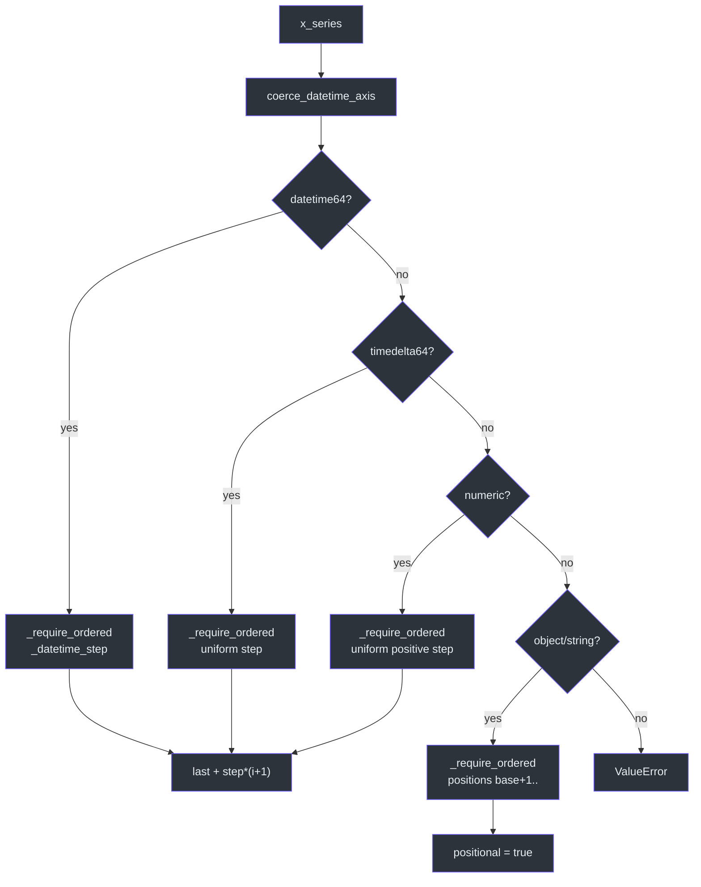
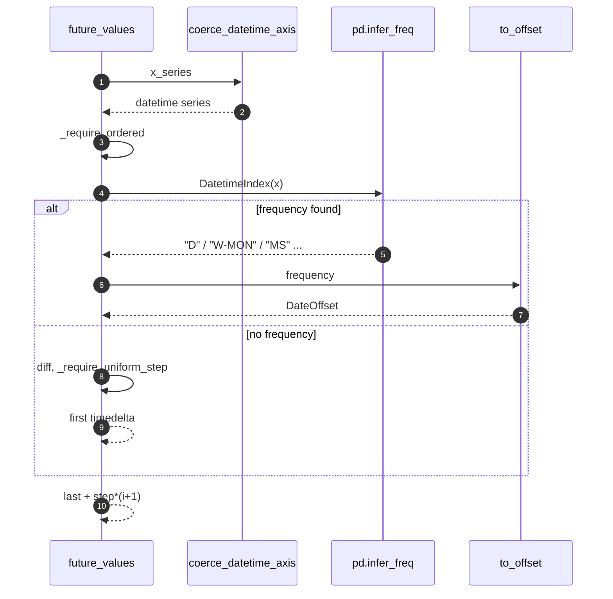
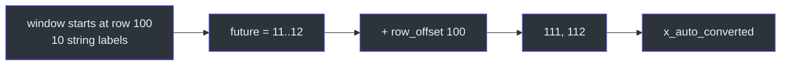
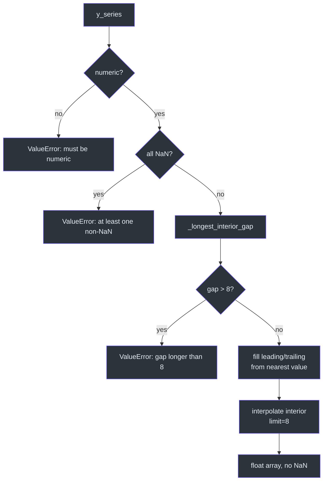

# Time Axis and Target Handling

## Why this is separate from the forecast

The null forecast itself is one line of arithmetic. Almost all of the code that
can fail lives in the two preparations around it: deciding what the future x
values are, and turning a possibly gappy target column into a clean array
([`src/series.py:1-10`](https://github.com/The-EPISERVE-Consortium/model__prediction__generic__null-model/blob/main/src/series.py#L1-L10)).
Keeping them in their own module means they can be tested exhaustively without
constructing a forecast.

| Function | Responsibility | Source |
|---|---|---|
| `coerce_datetime_axis` | Turn date-like objects/strings into datetimes when unambiguous | [`series.py:71-104`](https://github.com/The-EPISERVE-Consortium/model__prediction__generic__null-model/blob/main/src/series.py#L71-L104) |
| `future_values` | Extrapolate the horizon for the detected axis kind | [`series.py:136-191`](https://github.com/The-EPISERVE-Consortium/model__prediction__generic__null-model/blob/main/src/series.py#L136-L191) |
| `prepare_target` | Validate numeric target and fill/reject gaps | [`series.py:221-257`](https://github.com/The-EPISERVE-Consortium/model__prediction__generic__null-model/blob/main/src/series.py#L221-L257) |
| `_require_ordered` | NaN, uniqueness, monotonicity | [`series.py:30-45`](https://github.com/The-EPISERVE-Consortium/model__prediction__generic__null-model/blob/main/src/series.py#L30-L45) |
| `_require_uniform_step` | Constant spacing (ns tolerance for timedeltas) | [`series.py:48-68`](https://github.com/The-EPISERVE-Consortium/model__prediction__generic__null-model/blob/main/src/series.py#L48-L68) |

## Axis dispatch



<!-- Sources: src/series.py:136-191 -->

The branch order matters: a datetime column is also an object column in older
pandas dtypes, so the datetime check must come first. String labels that happen
to parse as dates are converted; strings that do not (ISO weeks such as
`2022-W01`) fall through to the positional branch
([`src/series.py:85-104`](https://github.com/The-EPISERVE-Consortium/model__prediction__generic__null-model/blob/main/src/series.py#L85-L104)).

## Datetime axes and calendar frequencies



<!-- Sources: src/series.py:107-133, src/series.py:162-166 -->

Using a calendar offset instead of a fixed `timedelta` is what makes daily data
survive DST and monthly data survive month lengths
([`src/series.py:107-129`](https://github.com/The-EPISERVE-Consortium/model__prediction__generic__null-model/blob/main/src/series.py#L107-L129)).
For sub-second irregularity the code compares nanoseconds with `atol=1`, not a
relative tolerance, so one second of drift on a daily series is not silently
accepted ([`src/series.py:59-64`](https://github.com/The-EPISERVE-Consortium/model__prediction__generic__null-model/blob/main/src/series.py#L59-L64)).

| Axis | Step used | Output | Example |
|---|---|---|---|
| Daily datetime | `pd.infer_freq` → `Day()` | next dates | 2026-08-18 → 2026-08-19 |
| Weekly datetime | `Week(weekday=…)` | next weeks | … |
| Monthly datetime | `MonthBegin()` | next months | 2026-01-01 → 2026-02-01 |
| Uniform timedelta | first diff | last + k·diff | `0 days 06:00:00` |
| Numeric | first diff (must be > 0) | last + k·diff | `1.0, 2.0, …` |
| String | row position | `n+1, n+2, …` + `x_auto_converted` | `2022-W01` → `3` |

Source: [`src/series.py:136-191`](https://github.com/The-EPISERVE-Consortium/model__prediction__generic__null-model/blob/main/src/series.py#L136-L191).

## String axes

A string axis has no arithmetic, so the model continues it as **1-indexed row
positions** and adds an `x_auto_converted` column
([`src/series.py:186-189`](https://github.com/The-EPISERVE-Consortium/model__prediction__generic__null-model/blob/main/src/series.py#L186-L189)):

```text
x, y, y_q10, y_q90
2022-W01, 10, 9, 11
...
```

becomes, for a window of 10 rows and 2 steps:

```text
x, x_auto_converted, y, y_q10, y_q90
11, 11, 10, 9, 11
12, 12, 10, 9, 11
```

The `row_offset` passed from `run.py` makes those positions absolute in the
whole input file, not relative to the window
([`src/model.py:99-101`](https://github.com/The-EPISERVE-Consortium/model__prediction__generic__null-model/blob/main/src/model.py#L99-L101)).



<!-- Sources: src/series.py:186-189, src/model.py:99-101, src/run.py:131-137 -->

## Target gap policy



<!-- Sources: src/series.py:221-257 -->

| Gap location | Length | Action |
|---|---|---|
| Interior | ≤ 8 | linear interpolation |
| Interior | > 8 | reject with an error naming the column |
| Leading | any | fill with first observed value |
| Trailing | any | fill with last observed value |
| Entire series | — | reject |

Source: [`src/series.py:22-25`](https://github.com/The-EPISERVE-Consortium/model__prediction__generic__null-model/blob/main/src/series.py#L22-L25),
[`src/series.py:242-257`](https://github.com/The-EPISERVE-Consortium/model__prediction__generic__null-model/blob/main/src/series.py#L242-L257).

The asymmetry is intentional: a leading/trailing gap means "the series starts or
ends later", and the nearest value is the best available statement about the
edge. An interior gap longer than 8 means the window no longer describes the
series, so fabricating it would make the null model dishonest
([`src/series.py:22-25`](https://github.com/The-EPISERVE-Consortium/model__prediction__generic__null-model/blob/main/src/series.py#L22-L25)).

## Related Pages

| Page | Why read it |
|---|---|
| [Execution Pipeline](./execution-pipeline.md) | Where these functions are called |
| [The Null Forecast](./null-forecast.md) | What happens to the prepared array |
| [Configuration](../01-getting-started/configuration.md) | `history_length` and the window |

## References

- [`src/series.py`](https://github.com/The-EPISERVE-Consortium/model__prediction__generic__null-model/blob/main/src/series.py)
- [`tests/test_series.py`](https://github.com/The-EPISERVE-Consortium/model__prediction__generic__null-model/blob/main/tests/test_series.py)
