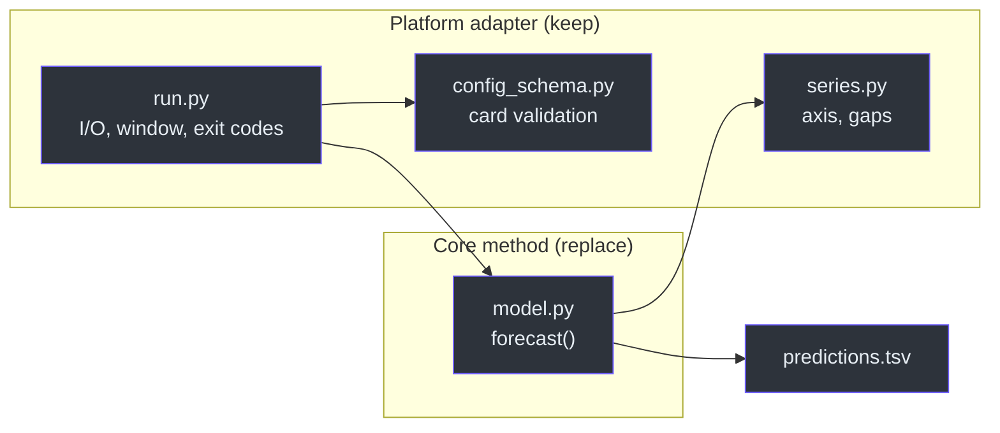
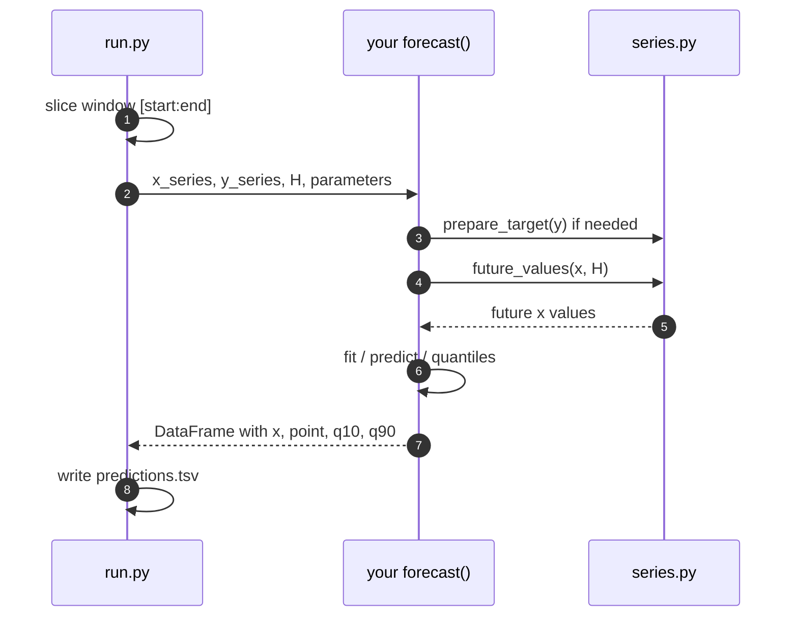
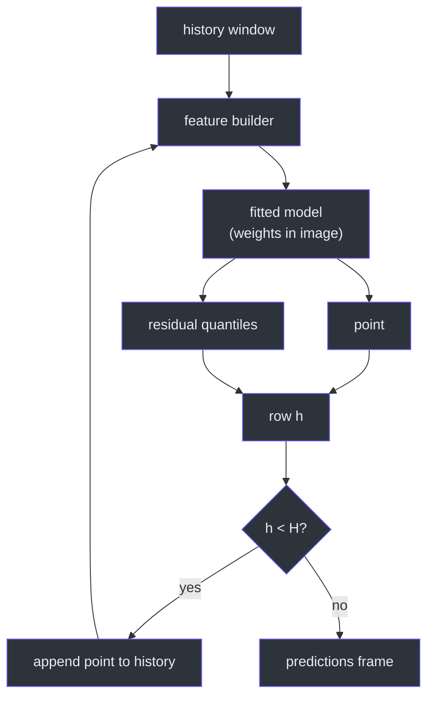
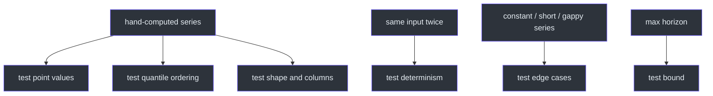
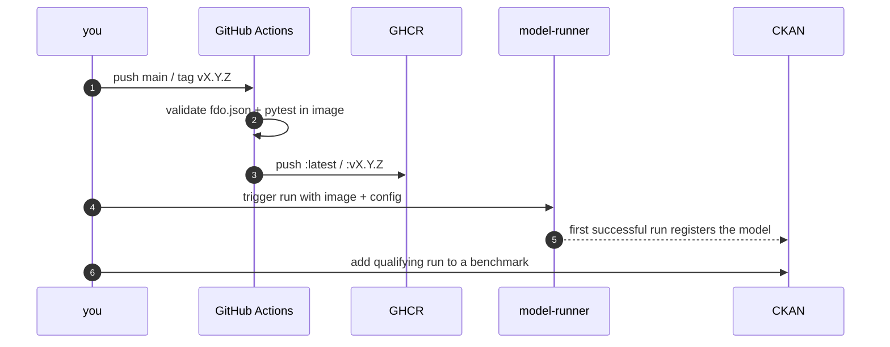

# Build Your Own Model

## Why this repository is a template

Most of an EPISERVE model is not the model. It is the adapter between the
platform and a forecasting method: reading `/work`, validating the card,
slicing the history window, extrapolating the time axis, filling gaps, writing
the TSV, and passing CI. This repository implements that adapter in about 650
lines and keeps the actual forecast in one small module
([`src/model.py:49-116`](https://github.com/The-EPISERVE-Consortium/model__prediction__generic__null-model/blob/main/src/model.py#L49-L116)).

That split is the template: **keep the adapter, replace the core**. A more
sophisticated method — gradient boosting, a transformer, a state-space model —
changes `src/model.py` and the card, not the container contract.



<!-- Sources: src/run.py:25-26, src/model.py:15, src/config_schema.py:98 -->

## Keep / replace

| Path | Action | Reason |
|---|---|---|
| `src/run.py` | Keep | The container contract, window slice and error format |
| `src/config_schema.py` | Keep | The card is already a JSON Schema; don't duplicate it |
| `src/series.py` | Keep | Axis inference and the gap policy are dataset-agnostic |
| `src/model.py` | **Replace** | This is the method |
| `tests/test_run.py` | Keep, extend | Locks the CLI contract |
| `tests/test_series.py` | Keep | Locks axis and gap behaviour |
| `tests/test_config_schema.py` | Keep, extend | Ties the card to the code |
| `tests/test_model.py` | **Replace** | Tests for your method |
| `fdo.json` | Edit | Name, parameters, I/O, resources, documentation |
| `Dockerfile`, `requirements*.txt` | Edit | Your runtime and dependencies |
| `.github/workflows/publish.yml` | Keep | Card check, in-image tests, GHCR |
| `documentation/` | Edit | Keep the pages truthful |

Source: [`src/`](https://github.com/The-EPISERVE-Consortium/model__prediction__generic__null-model/tree/main/src),
[`tests/`](https://github.com/The-EPISERVE-Consortium/model__prediction__generic__null-model/tree/main/tests).

## The core contract

Your replacement must keep this shape
([`src/model.py:49-55`](https://github.com/The-EPISERVE-Consortium/model__prediction__generic__null-model/blob/main/src/model.py#L49-L55)):

```python
def forecast(
    x_series: pd.Series,      # history x, already sliced
    y_series: pd.Series,      # history target, may contain NaN
    prediction_length: int,   # H
    **parameters,             # declared in fdo.json
) -> pd.DataFrame:
    ...
```

and this output
([`src/model.py:103-114`](https://github.com/The-EPISERVE-Consortium/model__prediction__generic__null-model/blob/main/src/model.py#L103-L114)):

| Column | Required | Meaning |
|---|---|---|
| `<x>` (input name) | yes | Future time value |
| `x_auto_converted` | only string axis | 1-indexed absolute row position |
| `<y>` (input name) | yes | Point forecast |
| `<y>_q10` | yes | Lower quantile |
| `<y>_q90` | yes | Upper quantile |



<!-- Sources: src/run.py:121-145, src/model.py:89-114 -->

The invariants that make the adapter work:

| Invariant | Consequence if broken |
|---|---|
| No file, network or clock access in the core | Tests need the platform; runs become non-reproducible |
| Same input + config → same output | Benchmark comparisons are meaningless |
| `q10 <= point <= q90` | Scoring rejects or penalises incoherent intervals |
| One row per step, exact column names | Runner postflight and scoring fail |
| Never read beyond the history window | Future leakage inflates the score |
| Respect `maxHorizon` | Memory/runtime blow-up in the Job |

Source: [`fdo.json:94-108`](https://github.com/The-EPISERVE-Consortium/model__prediction__generic__null-model/blob/main/fdo.json#L94-L108),
[`src/model.py:76-97`](https://github.com/The-EPISERVE-Consortium/model__prediction__generic__null-model/blob/main/src/model.py#L76-L97).

## Swapping in a sophisticated method

A realistic replacement keeps the interface and moves all complexity behind it.
The example below is a gradient-boosted, recursive one-step model; the point is
the shape, not the algorithm:

```python
def forecast(x_series, y_series, prediction_length, **params):
    values = prepare_target(y_series)          # reuse series.py
    future, positional = future_values(x_series, prediction_length)

    model = load_booster(params["model_path"])  # baked into the image
    history = list(values)
    rows = []
    for step in range(prediction_length):
        features = make_features(history, step, params)
        point = float(model.predict(features)[0])
        q10, q90 = residual_quantiles(model, features, params)
        rows.append(row(future[step], point, q10, q90))
        history.append(point)                   # recursive, not future data

    return pd.DataFrame(rows)
```



<!-- Sources: src/model.py:89-114, src/series.py:136, src/series.py:221 -->

Two details decide whether this is honest:

- **Recursive or direct?** If you feed predictions back, say so in the card and
  docs; the benchmark horizon is multi-step, so future actuals are unavailable.
- **Where do quantiles come from?** Use the method's predictive distribution, or
  a held-out residual distribution. Do not invent a fixed width.

## Card changes come first


<!-- Sources: fdo.json:31-67, src/config_schema.py:98-130 -->

For each new parameter, declare type, bounds, default and a description in
`episerve:parameters`. If it is the horizon, history or offset, add it to
`episerve:task.parameterRoles` so the benchmark workflow prefills it
([`fdo.json:24-28`](https://github.com/The-EPISERVE-Consortium/model__prediction__generic__null-model/blob/main/fdo.json#L24-L28)).
Update `tests/test_config_schema.py` in the same change; it is the guard that
keeps the card and the code from drifting.

If the method needs more runtime or memory, change `episerve:resources`. If it
needs network access or weights, set `network: true` and document why — the
default is an offline, self-contained image
([`fdo.json:111-117`](https://github.com/The-EPISERVE-Consortium/model__prediction__generic__null-model/blob/main/fdo.json#L111-L117)).

## Test the core, not the platform



<!-- Sources: tests/test_model.py:22-135 -->

Keep the existing CLI tests untouched: they already prove the container contract
end to end ([`tests/test_run.py:153-170`](https://github.com/The-EPISERVE-Consortium/model__prediction__generic__null-model/blob/main/tests/test_run.py#L153-L170)).
Add to `test_model.py` only what is specific to your method.

## Publish and register



<!-- Sources: .github/workflows/publish.yml:17-83, README.md:120-127 -->

The first successful run is what creates the catalog entry; there is no manual
registration step. A benchmark entry additionally requires the run's provenance
to show exactly the benchmark input at the pinned commit.

## Anti-patterns

| Don't | Why it breaks |
|---|---|
| Re-read the parquet inside the core | Purity, testability, and the runner's window contract |
| Hardcode `datum` / `viruslast_normalisiert` | The model must work on any two-column series |
| Add parameters only in Python | The API rejects undeclared keys; the card is the contract |
| Train at inference | The benchmark measures forecasting, not fitting |
| Download weights at run time | `network: false`; non-reproducible runs |
| Use rows after the window | Future leakage; invalid benchmark entry |
| Return a fixed interval width | Coverage/interval score become meaningless |
| Ignore `maxHorizon` | OOM or timeout in Kubernetes |

Source: [`fdo.json:31-35`](https://github.com/The-EPISERVE-Consortium/model__prediction__generic__null-model/blob/main/fdo.json#L31-L35),
[`src/run.py:100-125`](https://github.com/The-EPISERVE-Consortium/model__prediction__generic__null-model/blob/main/src/run.py#L100-L125),
[`README.md:129-138`](https://github.com/The-EPISERVE-Consortium/model__prediction__generic__null-model/blob/main/README.md#L129-L138).

## Checklist

- [ ] Rename the image, repository and card `name`/`url`.
- [ ] Declare parameters, roles, resources and I/O in `fdo.json`.
- [ ] Replace `src/model.py`, keep the signature and output schema.
- [ ] Reuse `series.py` for axis and gaps.
- [ ] Add core tests; keep CLI, series and card tests green.
- [ ] Update `documentation/` and `README.md`.
- [ ] Build and run the container contract locally.
- [ ] Publish `:latest` and a pinned tag.
- [ ] Trigger one run; confirm the catalog entry.
- [ ] Add a benchmark entry with the pinned input.

For an agent-oriented, file-by-file brief, see
[`MODEL_TEMPLATE.md`](https://github.com/The-EPISERVE-Consortium/model__prediction__generic__null-model/blob/main/MODEL_TEMPLATE.md).

## Related Pages

| Page | Why read it |
|---|---|
| [Container Contract](../01-getting-started/container-contract.md) | The exact files and exit codes |
| [The Null Forecast](../02-architecture/null-forecast.md) | The reference core implementation |
| [Model Card and Config Validation](../02-architecture/model-card-and-validation.md) | How the card drives validation |
| [Contributor Guide](../onboarding/contributor-guide.md) | Testing and contribution workflow |

## References

- [`MODEL_TEMPLATE.md`](https://github.com/The-EPISERVE-Consortium/model__prediction__generic__null-model/blob/main/MODEL_TEMPLATE.md)
- [`fdo.json`](https://github.com/The-EPISERVE-Consortium/model__prediction__generic__null-model/blob/main/fdo.json)
- [`src/model.py`](https://github.com/The-EPISERVE-Consortium/model__prediction__generic__null-model/blob/main/src/model.py)
