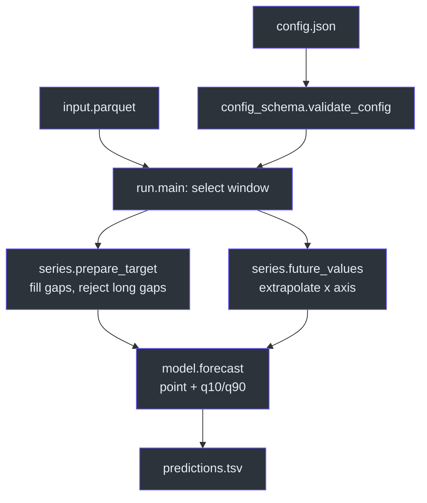
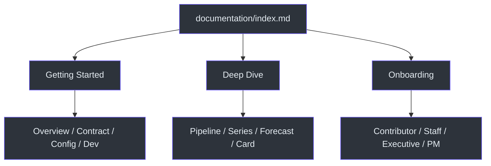

# model__prediction__generic__null-model

A dataset-agnostic **null forecaster** for the EPISERVE platform. It reads a time
series, computes one statistic of a trailing window (`mean`, `median` or
`last`), and writes that same value for every forecast step together with the
window's empirical 10th and 90th percentiles. It has no weights, no training, no
network access and no GPU — it is the performance floor that every real model
must beat, and a five-second end-to-end check of the model-runner pipeline
([`fdo.json:119-127`](https://github.com/The-EPISERVE-Consortium/model__prediction__generic__null-model/blob/main/fdo.json#L119-L127)).

## Quick start

```bash
# 1. Install the two runtime dependencies plus pytest
python3 -m venv .venv && source .venv/bin/activate
pip install -r requirements.txt -r requirements-test.txt

# 2. Put a config and a parquet file under ./work/input/
mkdir -p work/input work/output
cat > work/input/config.json <<'JSON'
{"history_length": 34, "prediction_length": 8, "statistic": "mean"}
JSON
# work/input/input.parquet: first column = time axis, second = target

# 3. Run
WORK_DIR=./work python src/run.py

# 4. Inspect
column -t -s $'\t' work/output/predictions.tsv
```

Expected shape for a numeric target `y`: one row per step, with `y`,
`y_q10` and `y_q90` constant across rows
([`src/model.py:106-114`](https://github.com/The-EPISERVE-Consortium/model__prediction__generic__null-model/blob/main/src/model.py#L106-L114)).

## Architecture at a glance



<!-- Sources: src/run.py:74, src/run.py:104-137, src/model.py:49-114, src/series.py:136, src/series.py:221 -->

The pipeline is deliberately linear: **validate → slice → prepare → forecast →
write**. There is no state between runs and no side channel
([`src/run.py:47-148`](https://github.com/The-EPISERVE-Consortium/model__prediction__generic__null-model/blob/main/src/run.py#L47-L148)).



<!-- Sources: catalogue.json -->

## Documentation map

| Section | What it answers | Start here |
|---|---|---|
| Getting Started | What the model is, the container contract, config keys, local dev | [Overview](./01-getting-started/overview.md) |
| Deep Dive | How the pipeline, axis handling, forecast and validation actually work | [Execution Pipeline](./02-architecture/execution-pipeline.md) |
| Onboarding | Role-specific paths: contributor, staff engineer, executive, PM | [Contributor Guide](./onboarding/contributor-guide.md) |
| Building a Model | How to reuse this repository for a new model | [Build Your Own Model](./03-template/build-your-own-model.md) |

### Getting Started

| Page | Description |
|---|---|
| [Overview](./01-getting-started/overview.md) | Purpose, flat forecast, benchmark role |
| [Container Contract](./01-getting-started/container-contract.md) | `/work` I/O, exit codes, `--check-config` |
| [Configuration](./01-getting-started/configuration.md) | The four parameters and their bounds |
| [Local Development](./01-getting-started/local-development.md) | Run, test, build, publish |

### Deep Dive

| Page | Description |
|---|---|
| [Execution Pipeline](./02-architecture/execution-pipeline.md) | `main()` step by step, including failures |
| [Time Axis and Target Handling](./02-architecture/series-handling.md) | Datetime/numeric/string axes, gap policy |
| [The Null Forecast](./02-architecture/null-forecast.md) | Point statistic, quantiles, clamping |
| [Model Card and Config Validation](./02-architecture/model-card-and-validation.md) | Card-driven JSON Schema validation |

### Building a Model

| Page | Description |
|---|---|
| [Build Your Own Model](./03-template/build-your-own-model.md) | Reuse this repo: keep the adapter, replace the core method |

### Onboarding

| Guide | Audience |
|---|---|
| [Contributor Guide](./onboarding/contributor-guide.md) | New contributors |
| [Staff Engineer Guide](./onboarding/staff-engineer-guide.md) | Staff/principal engineers |
| [Executive Guide](./onboarding/executive-guide.md) | Engineering leaders |
| [Product Manager Guide](./onboarding/product-manager-guide.md) | PMs and stakeholders |

## Key files

| File | Responsibility | Source |
|---|---|---|
| `src/run.py` | Container entry point, I/O, window selection, exit codes | [`src/run.py:47`](https://github.com/The-EPISERVE-Consortium/model__prediction__generic__null-model/blob/main/src/run.py#L47) |
| `src/config_schema.py` | Loads `episerve:parameters` from the card and validates `config.json` | [`src/config_schema.py:102`](https://github.com/The-EPISERVE-Consortium/model__prediction__generic__null-model/blob/main/src/config_schema.py#L102) |
| `src/series.py` | X-axis extrapolation and target gap handling | [`src/series.py:136`](https://github.com/The-EPISERVE-Consortium/model__prediction__generic__null-model/blob/main/src/series.py#L136) |
| `src/model.py` | Point statistic, empirical quantiles, output frame | [`src/model.py:49`](https://github.com/The-EPISERVE-Consortium/model__prediction__generic__null-model/blob/main/src/model.py#L49) |
| `fdo.json` | Model card: parameters, I/O, resources, documentation | [`fdo.json:31`](https://github.com/The-EPISERVE-Consortium/model__prediction__generic__null-model/blob/main/fdo.json#L31) |
| `Dockerfile` | `python:3.11-slim` image, entrypoint `src/run.py` | [`Dockerfile:1-10`](https://github.com/The-EPISERVE-Consortium/model__prediction__generic__null-model/blob/main/Dockerfile#L1-L10) |
| `.github/workflows/publish.yml` | Card validation, in-image tests, GHCR push | [`.github/workflows/publish.yml:17`](https://github.com/The-EPISERVE-Consortium/model__prediction__generic__null-model/blob/main/.github/workflows/publish.yml#L17) |

## Tech stack

| Layer | Choice | Why |
|---|---|---|
| Language | Python 3.11 | Matches the other EPISERVE model images |
| Data | pandas + pyarrow | Parquet input, TSV output |
| Numerics | NumPy | Mean, median and quantiles |
| Validation | jsonschema (Draft 2020-12) | The card is already a JSON Schema |
| Packaging | Docker, `python:3.11-slim` | Platform contract is a container |
| CI/CD | GitHub Actions → GHCR | Build, test inside the image, push tags |

## Reading paths

- **First contact** → [Overview](./01-getting-started/overview.md) → [Container Contract](./01-getting-started/container-contract.md) → [Configuration](./01-getting-started/configuration.md)
- **Changing the code** → [Execution Pipeline](./02-architecture/execution-pipeline.md) → [The Null Forecast](./02-architecture/null-forecast.md) → [Contributor Guide](./onboarding/contributor-guide.md)
- **Reusing this as a template** → [Build Your Own Model](./03-template/build-your-own-model.md) → [`MODEL_TEMPLATE.md`](https://github.com/The-EPISERVE-Consortium/model__prediction__generic__null-model/blob/main/MODEL_TEMPLATE.md)
- **Reviewing the design** → [Staff Engineer Guide](./onboarding/staff-engineer-guide.md) → [Model Card and Config Validation](./02-architecture/model-card-and-validation.md)
- **Non-engineering** → [Product Manager Guide](./onboarding/product-manager-guide.md) → [Executive Guide](./onboarding/executive-guide.md)
