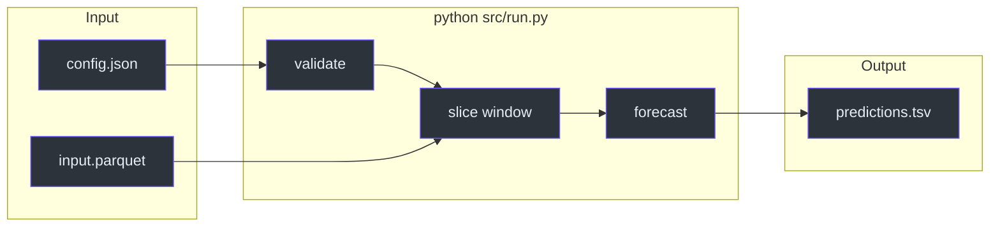
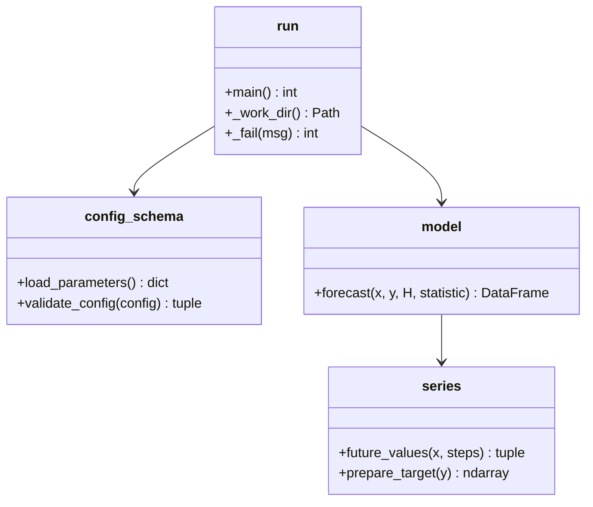
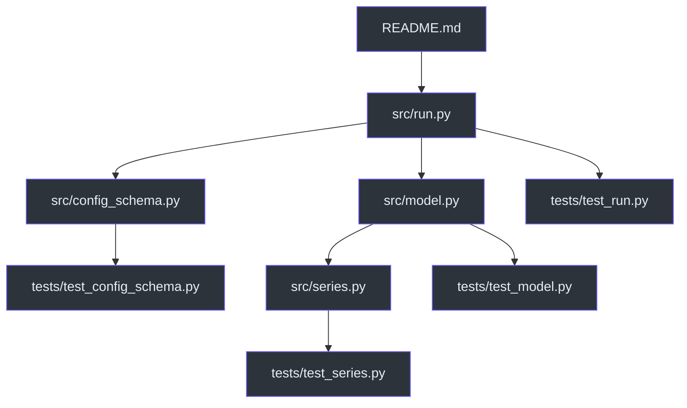
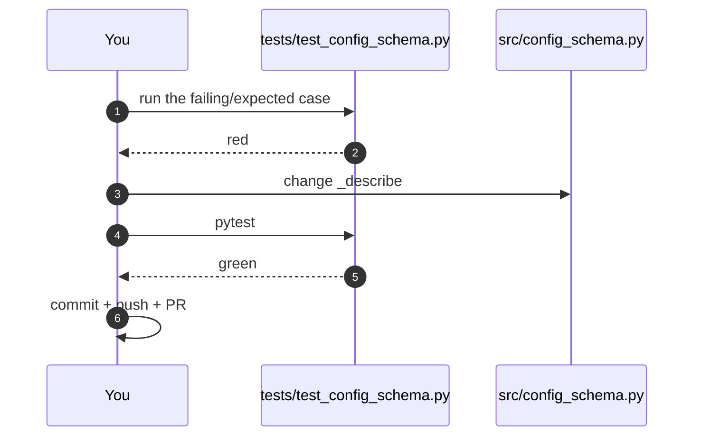
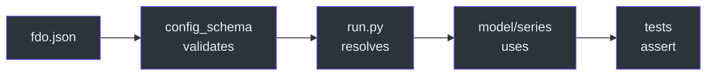
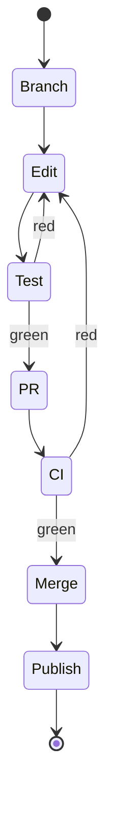

# Contributor Guide

This guide assumes you can read Python and have used pandas at least once. It
does not assume you know EPISERVE, forecasting, or this repository.

## Prerequisites → new → deferred

| You should already know | This guide introduces | Deliberately deferred |
|---|---|---|
| Python functions, type hints, exceptions | The `/work` container contract | Kubernetes Job internals |
| pandas `Series`/`DataFrame` basics | JSON Schema validation | Prefect orchestration |
| pytest basics | Direct vs recursive forecasting | lakeFS object layout |
| git branches and PRs | The model card as a contract | Benchmark scoring formulas |

## Part I — The domain in one page

A **forecast model** on EPISERVE is a container. It receives a time series and a
JSON config, and returns a table of future values. Nothing else crosses the
boundary. This model's answer is deliberately boring: it computes one number from
the recent past and repeats it
([`src/model.py:1-10`](https://github.com/The-EPISERVE-Consortium/model__prediction__generic__null-model/blob/main/src/model.py#L1-L10)).



<!-- Sources: src/run.py:47-148 -->

Two ideas make the rest of the codebase legible:

1. **The window is the model.** Everything before `forecast()` exists to turn
   files into two clean `Series`; everything after exists to turn one number into
   a TSV ([`src/run.py:121-145`](https://github.com/The-EPISERVE-Consortium/model__prediction__generic__null-model/blob/main/src/run.py#L121-L145)).
2. **The card is the contract.** User-facing parameter bounds live in
   `fdo.json` and are enforced through `jsonschema`; a few structural constants
   (`MIN_CONTEXT`, `MAX_PREDICTION_STEPS`) are mirrored in the card and checked
   by the tests
   ([`src/config_schema.py:38-68`](https://github.com/The-EPISERVE-Consortium/model__prediction__generic__null-model/blob/main/src/config_schema.py#L38-L68)).

## Part II — The four modules



<!-- Sources: src/run.py:25-26, src/model.py:15, src/series.py, src/config_schema.py -->

| Module | You touch it when… | Read first |
|---|---|---|
| `src/run.py` | changing I/O, error messages, window selection | [`run.py:47-148`](https://github.com/The-EPISERVE-Consortium/model__prediction__generic__null-model/blob/main/src/run.py#L47-L148) |
| `src/config_schema.py` | adding/renaming a parameter, changing validation text | [`config_schema.py:98-130`](https://github.com/The-EPISERVE-Consortium/model__prediction__generic__null-model/blob/main/src/config_schema.py#L98-L130) |
| `src/series.py` | supporting a new axis kind or gap policy | [`series.py:136-257`](https://github.com/The-EPISERVE-Consortium/model__prediction__generic__null-model/blob/main/src/series.py#L136-L257) |
| `src/model.py` | changing the forecast statistic or interval | [`model.py:27-116`](https://github.com/The-EPISERVE-Consortium/model__prediction__generic__null-model/blob/main/src/model.py#L27-L116) |

### Reading order



<!-- Sources: repository layout -->

Start at `run.py` because it is the only place that knows the order of
operations; every other module is called from there.

## Part III — Getting productive

### Setup

```bash
git clone https://github.com/The-EPISERVE-Consortium/model__prediction__generic__null-model.git
cd model__prediction__generic__null-model
python3 -m venv .venv && source .venv/bin/activate
pip install -r requirements.txt -r requirements-test.txt
pytest tests/ -v
```

You should see 83 passing tests in a few seconds.

### Your first task: change a message

A good first change is improving one error message in `_describe`
([`src/config_schema.py:71-95`](https://github.com/The-EPISERVE-Consortium/model__prediction__generic__null-model/blob/main/src/config_schema.py#L71-L95)).
The loop is:



<!-- Sources: tests/test_config_schema.py:96-135, src/config_schema.py:71-95 -->

### Adding a parameter (the full checklist)

This is the most common non-trivial change, and it touches five places:

| Step | File | Why |
|---|---|---|
| 1. Declare it | `fdo.json` → `episerve:parameters.properties` | The card is the source of truth |
| 2. Give it a default/bounds | same block | Validation and API prefill |
| 3. Read it | `src/run.py:84-87` | Pass it to the model |
| 4. Implement it | `src/model.py` or `src/series.py` | Behaviour |
| 5. Test it | `tests/test_*.py` | Lock the contract |



<!-- Sources: fdo.json:31-67, src/run.py:84-87, tests/test_config_schema.py:22-60 -->

`tests/test_config_schema.py:22-60` is the guard that keeps the card and the
Python constants in sync; if you add a bound, add it there too.

### Testing strategy

| Layer | File | Style |
|---|---|---|
| Pure functions | `test_series.py`, `test_model.py` | construct a Series, assert output |
| Card/validator | `test_config_schema.py` | parameterised bad configs |
| CLI end-to-end | `test_run.py` | temp `WORK_DIR`, call `main()`, read TSV |

Run one test while iterating:

```bash
pytest tests/test_model.py::test_quantiles_are_empirical_quantiles_of_the_window -v
```

### Debugging

| Symptom | First check |
|---|---|
| `config.json not found` | `WORK_DIR` and `_work_dir()` |
| `x values must have a uniform step` | print `x.diff().value_counts()` |
| `history must contain at least 3 points` | window slice indices |
| Output columns wrong | input column order (time first, target second) |

## Glossary

| Term | Meaning here |
|---|---|
| **Window** | The `history_length` rows whose statistic is repeated |
| **Offset** | Rows skipped at the end, for back-testing |
| **Direct forecast** | Compute once, repeat; no feedback of predictions |
| **Recursive forecast** | Feed each prediction back into the window (not implemented) |
| **Null model** | A baseline with no trend/seasonality/covariates |
| **Model card** | `fdo.json`, the machine-readable contract |
| **`episerve:parameters`** | The JSON Schema inside the card |

## Contribution workflow

1. Branch from `main`.
2. Make the smallest change that satisfies the card.
3. `pytest tests/ -v` — all green.
4. `episerve-validate fdo.json` if the card changed.
5. Open a PR; CI runs the card check and the in-image tests.
6. Merge; `main` publishes `:latest` automatically.



<!-- Sources: .github/workflows/publish.yml:17-83 -->

## Key files

| File | Lines | Read it for |
|---|---|---|
| `src/run.py` | 152 | orchestration and error contract |
| `src/series.py` | 257 | axis and gap edge cases |
| `src/model.py` | 116 | forecast arithmetic |
| `src/config_schema.py` | 130 | validation and messages |
| `fdo.json` | 128 | the contract |
| `tests/test_run.py` | 232 | end-to-end expectations |

## Related Pages

| Page | Why read it |
|---|---|
| [Execution Pipeline](../02-architecture/execution-pipeline.md) | The detailed trace |
| [The Null Forecast](../02-architecture/null-forecast.md) | The arithmetic |
| [Local Development](../01-getting-started/local-development.md) | Commands |
| [Staff Engineer Guide](./staff-engineer-guide.md) | When you need the "why" |

## References

- [`README.md`](https://github.com/The-EPISERVE-Consortium/model__prediction__generic__null-model/blob/main/README.md)
- [`src/`](https://github.com/The-EPISERVE-Consortium/model__prediction__generic__null-model/tree/main/src)
- [`tests/`](https://github.com/The-EPISERVE-Consortium/model__prediction__generic__null-model/tree/main/tests)
