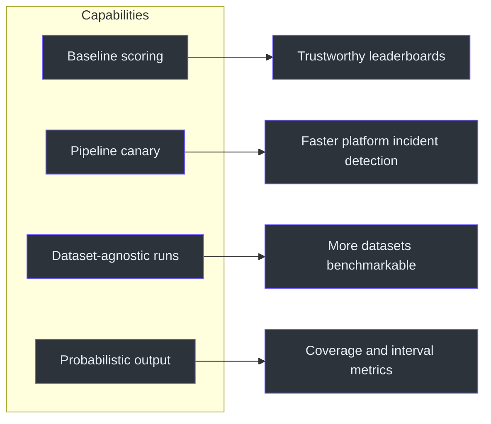
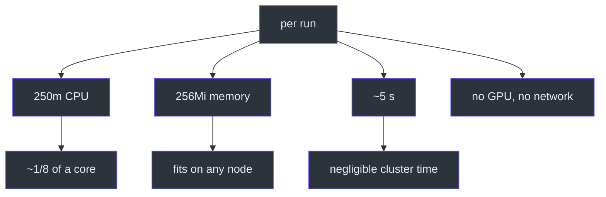
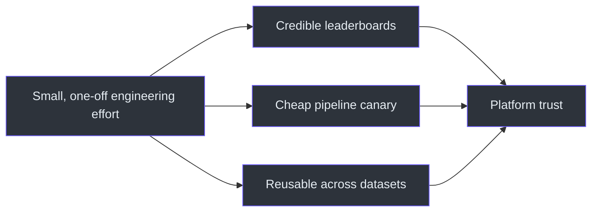

# Executive Guide

## What it is, in one paragraph

The null model is a deliberately simple forecasting baseline. It looks at a
recent window of data, computes one summary number — the average, the median, or
the latest value — and predicts that the future will stay at that level. It also
reports a plausible range around that number. It trains nothing, downloads
nothing, and runs in about five seconds on a quarter of a CPU
([`fdo.json:111-117`](https://github.com/The-EPISERVE-Consortium/model__prediction__generic__null-model/blob/main/fdo.json#L111-L117)).

Its value is not accuracy. Its value is **comparability**: it gives every
benchmark a defensible floor, so a leaderboard can say "this model beats doing
nothing" rather than only "this model beats the other model".

## Capability map

<!-- Sources: fdo.json:18-29, README.md:1-12 -->

| Capability | Business effect |
|---|---|
| Baseline scoring | Leaderboard claims become falsifiable |
| Pipeline canary | Platform regressions surface in minutes, not days |
| Dataset-agnostic | No per-dataset engineering to add a benchmark |
| Probabilistic output | Enables interval score and coverage, not just MAE |

## Cost and scaling

<!-- Sources: fdo.json:111-117 -->

The cost model is linear in the number of runs and effectively zero per run.
The dominant cost is orchestration overhead (scheduling a Kubernetes Job), not
compute. At platform scale the model is cheaper than the metadata written about
it.

## Risk assessment

| Risk | Likelihood | Impact | Mitigation |
|---|---|---|---|
| Baseline mistaken for a real forecaster | Medium | Medium | Card says "performance floor"; docs repeat it |
| Window tuning overfits a benchmark | High | Medium | Publish parameter choices; compare across benchmarks |
| Dependency drift breaks reproducibility | Medium | Low | Pin versions in a future release |
| Long gaps silently imputed | Low | High | Gaps >8 rows are rejected, not filled |
| String axes produce non-date labels | Medium | Low | `x_auto_converted` makes the convention explicit |
| Leaderboard dominated by tuned baselines | Medium | Medium | Report ranks by multiple metrics; document tuning |

Sources: [`fdo.json:119-127`](https://github.com/The-EPISERVE-Consortium/model__prediction__generic__null-model/blob/main/fdo.json#L119-L127),
[`src/series.py:22-25`](https://github.com/The-EPISERVE-Consortium/model__prediction__generic__null-model/blob/main/src/series.py#L22-L25),
[`README.md:164-172`](https://github.com/The-EPISERVE-Consortium/model__prediction__generic__null-model/blob/main/README.md#L164-L172).

The overfitting risk is real and worth stating plainly: on the AMELAG benchmark,
changing the window from 8 to 34 weeks moved the interval-score rank from last
to ninth. That is a property of the test window, not evidence that a 34-week mean
is universally better. The baseline should be re-evaluated per benchmark, and the
chosen parameters should be recorded with the entry.

## Investment thesis

<!-- Sources: README.md:1-12, fdo.json:18-29 -->

The effort is already sunk and the maintenance surface is four small Python
files plus one JSON card. The return is a permanent, auditable floor for every
forecast benchmark and a canary that exercises the full model-runner path. The
alternative — no baseline — makes every leaderboard claim weaker for zero
savings.

## Recommendations

1. **Keep it deployed and registered.** It is the cheapest trust mechanism the
   platform has.
2. **Label it as a baseline in the catalog.** The card already does; make sure
   the UI does too.
3. **Record the chosen window per benchmark entry.** Avoid presenting a tuned
   baseline as a neutral default.
4. **Pin dependencies before the next release.** The only acknowledged
   reproducibility gap.
5. **Do not extend it into a real forecaster.** New hypotheses belong in new
   model repositories; this one should stay a floor.

## Related Pages

| Page | Why read it |
|---|---|
| [Product Manager Guide](./product-manager-guide.md) | The same story for non-engineering stakeholders |
| [Staff Engineer Guide](./staff-engineer-guide.md) | The technical tradeoffs behind these risks |
| [Overview](../01-getting-started/overview.md) | The model in plain terms |

## References

- [`fdo.json`](https://github.com/The-EPISERVE-Consortium/model__prediction__generic__null-model/blob/main/fdo.json)
- [`README.md`](https://github.com/The-EPISERVE-Consortium/model__prediction__generic__null-model/blob/main/README.md)
