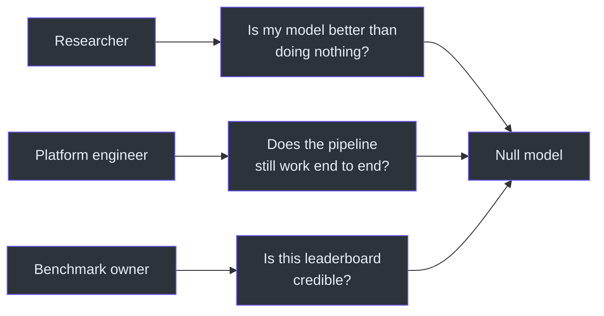
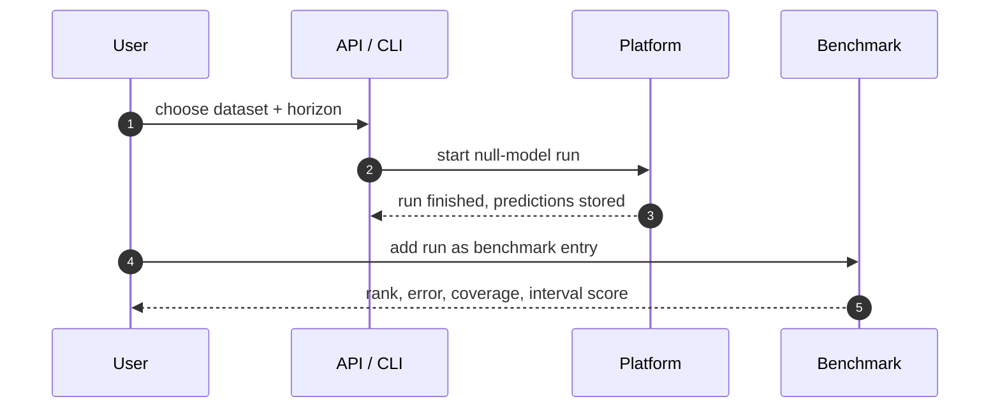
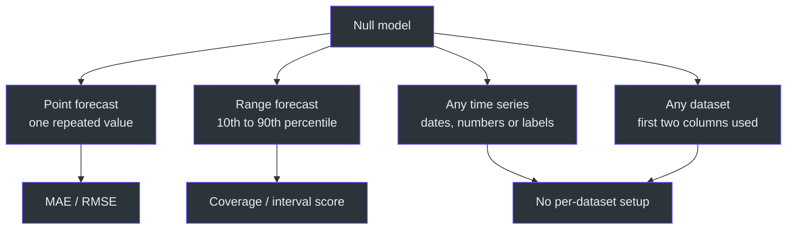

# Product Manager Guide

## What users get

The null model answers a simple question: **"If we assumed nothing changes, what
would the forecast look like?"** It looks at the recent history of a dataset,
picks one representative number — the average, the middle value, or the latest
value — and predicts that the future stays there. It also gives a range that
reflects how much the recent history moved around
([`README.md:14-26`](https://github.com/The-EPISERVE-Consortium/model__prediction__generic__null-model/blob/main/README.md#L14-L26)).

That is intentionally unambitious. Its job is to be the **benchmark floor**: the
number every real model must beat before its result means anything.

## Who uses it, and why

<!-- Sources: README.md:1-12, fdo.json:119-127 -->

| User | Job to be done | What they get |
|---|---|---|
| Researcher | Compare a new model against a fair floor | A baseline entry on the leaderboard |
| Platform engineer | Verify the model pipeline after a change | A five-second end-to-end run |
| Benchmark owner | Make leaderboard claims defensible | A permanent reference point |
| Data curator | Add a dataset without custom code | A model that runs on any two-column series |

## The user journey

<!-- Sources: README.md:120-127, fdo.json:18-29 -->

The user never edits code. They choose a dataset and a horizon; the platform
fills in the history window and runs the container.

## Capability map

<!-- Sources: fdo.json:18-29, fdo.json:69-108 -->

| Capability | Available | Notes |
|---|---|---|
| Predict a future level | Yes | One number, repeated |
| Give a range | Yes | Based on recent variation |
| Use extra data (weather, mobility) | No | Extra columns are ignored |
| Follow a trend or season | No | That is a different model |
| Run on a new dataset | Yes | Time column first, target second |
| Run without internet | Yes | No downloads, no weights |

## Known limitations

| Limitation | What it means for a user |
|---|---|
| The forecast is flat | It will not follow a rising or falling wave |
| The range is historical spread | It is not a guarantee of future uncertainty |
| One series per run | No multi-region or multi-age-group forecasts in one call |
| Long gaps are rejected | A dataset with more than 8 missing rows in a row cannot run |
| String dates become positions | The output shows row numbers, not new labels |
| Window choice matters | A different history length can change the result a lot |

Sources: [`README.md:129-138`](https://github.com/The-EPISERVE-Consortium/model__prediction__generic__null-model/blob/main/README.md#L129-L138),
[`src/series.py:22-25`](https://github.com/The-EPISERVE-Consortium/model__prediction__generic__null-model/blob/main/src/series.py#L22-L25).

The last one deserves emphasis: on one real benchmark, changing the history from
8 to 34 weeks moved the model from last place to ninth place on interval score.
The baseline is sensitive to that choice, so the chosen window should be shown
next to any result.

## Data and privacy

| Question | Answer |
|---|---|
| Does it store data? | No; it reads the input file and writes the output file |
| Does it send data anywhere? | No; network access is disabled |
| Does it train on data? | No; there are no parameters or weights |
| Does it need credentials? | No |
| What does it keep? | Nothing after the run; the platform stores the output |

Source: [`fdo.json:111-117`](https://github.com/The-EPISERVE-Consortium/model__prediction__generic__null-model/blob/main/fdo.json#L111-L117),
[`fdo.json:123`](https://github.com/The-EPISERVE-Consortium/model__prediction__generic__null-model/blob/main/fdo.json#L123).

## FAQ

**Is this a real forecast?**
It is a real forecast of a deliberately simple hypothesis: "the future looks like
the recent average". It is not expected to be accurate; it is expected to be a
fair floor.

**Why is every predicted value the same?**
Because the model computes one number and repeats it. That is the definition of
this baseline, not a bug ([`README.md:14-26`](https://github.com/The-EPISERVE-Consortium/model__prediction__generic__null-model/blob/main/README.md#L14-L26)).

**Can it use weather or mobility data?**
No. It reads only the time column and the target column. A model that uses
covariates is a different model.

**Why does the range look so wide?**
It is the spread of the recent history. A window that contains a big wave
produces a wide range.

**What happens if the data has gaps?**
Short gaps (up to 8 rows) are filled; longer gaps stop the run with a clear
message ([`src/series.py:22-25`](https://github.com/The-EPISERVE-Consortium/model__prediction__generic__null-model/blob/main/src/series.py#L22-L25)).

**How long does a run take?**
About five seconds, with no GPU and no network
([`fdo.json:116`](https://github.com/The-EPISERVE-Consortium/model__prediction__generic__null-model/blob/main/fdo.json#L116)).

**Can we change the history length?**
Yes, it is a run parameter. The platform can prefill it from the benchmark, and
the chosen value should be recorded with the result.

## Related Pages

| Page | Why read it |
|---|---|
| [Executive Guide](./executive-guide.md) | Cost, risk and investment view |
| [Overview](../01-getting-started/overview.md) | The model in technical terms |
| [Configuration](../01-getting-started/configuration.md) | The parameters a user can set |

## References

- [`README.md`](https://github.com/The-EPISERVE-Consortium/model__prediction__generic__null-model/blob/main/README.md)
- [`fdo.json`](https://github.com/The-EPISERVE-Consortium/model__prediction__generic__null-model/blob/main/fdo.json)
