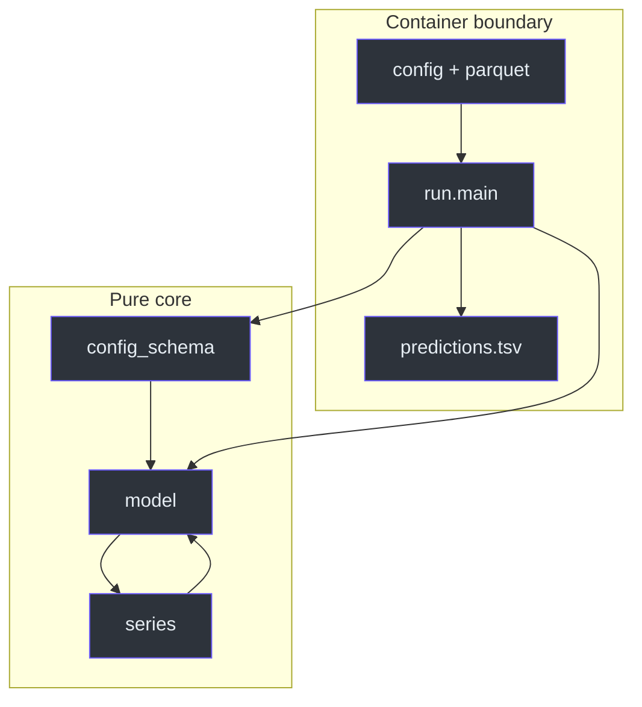
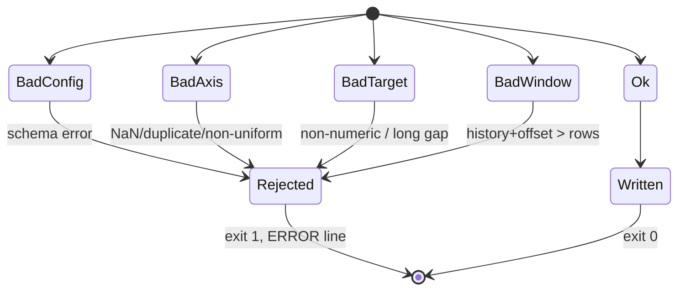
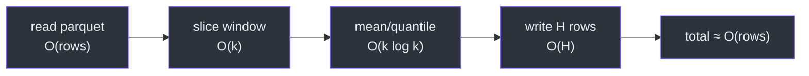
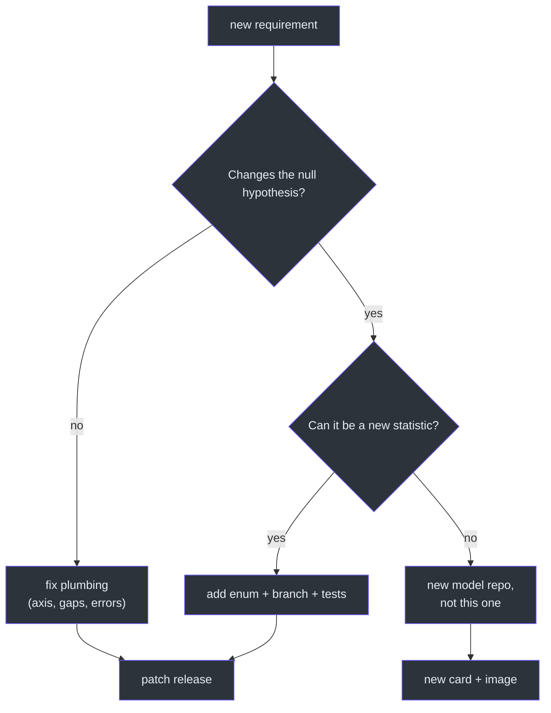

# Staff Engineer Guide

## The one insight

**The model is not the code; the window is the model.** Everything else is a
plumbing decision about how to obtain a clean window and how to serialize one
number. Once you accept that, the absence of a framework, a model registry or a
dependency-injection layer is not an omission — it is the design
([`src/model.py:1-10`](https://github.com/The-EPISERVE-Consortium/model__prediction__generic__null-model/blob/main/src/model.py#L1-L10)).

The corollary is that the risk surface is not in the forecast; it is in the
boundary. Axis inference, gap policy, config validation and the error contract
are where runs fail and where platform compatibility is won or lost
([`src/series.py:136-257`](https://github.com/The-EPISERVE-Consortium/model__prediction__generic__null-model/blob/main/src/series.py#L136-L257)).

## System shape



<!-- Sources: src/run.py:25-26, src/model.py:15 -->

The core is pure: `forecast(x, y, H, statistic)` has no I/O, no globals and no
clock. That is what makes the 83-test suite fast and deterministic
([`src/model.py:49-55`](https://github.com/The-EPISERVE-Consortium/model__prediction__generic__null-model/blob/main/src/model.py#L49-L55)).

## Decision log

| # | Decision | Alternative rejected | Why |
|---|---|---|---|
| 1 | Flat direct forecast | Recursive sliding window | Recursion only damps the last difference; worse at the chosen 34-week window (13,340 vs 8,866) |
| 2 | Empirical q10/q90 | Parametric normal interval | No distributional assumption; honest for skewed windows |
| 3 | Clamp point into interval | Report incoherent interval | A point outside its own interval is unusable for scoring |
| 4 | Card-driven JSON Schema | Python constants + docs | One source of truth for API, CLI and tests |
| 5 | `ERROR:` line, exit 1 | Traceback | Runner must parse failures without Python knowledge |
| 6 | First two columns only | Named target lookup | Works on covariate benchmark inputs without SQL |
| 7 | String axis → row positions | Reject string axes | ISO-week datasets are common; positions are unambiguous |
| 8 | Gap ≤8 interpolate, else reject | Impute everything | Long gaps are not the same series; fabricating them is dishonest |

Sources: [`src/model.py:27-116`](https://github.com/The-EPISERVE-Consortium/model__prediction__generic__null-model/blob/main/src/model.py#L27-L116),
[`src/series.py:22-25`](https://github.com/The-EPISERVE-Consortium/model__prediction__generic__null-model/blob/main/src/series.py#L22-L25),
[`src/config_schema.py:38-72`](https://github.com/The-EPISERVE-Consortium/model__prediction__generic__null-model/blob/main/src/config_schema.py#L38-L72),
[`README.md:164-172`](https://github.com/The-EPISERVE-Consortium/model__prediction__generic__null-model/blob/main/README.md#L164-L172).

## Pseudocode (TypeScript)

The Python is short enough to transliterate, which is a useful test of whether
the design is actually simple:

```ts
function forecast(x: Series, y: Series, h: number, stat: Stat): Row[] {
  assert(h > 0 && h <= 512);
  assert(x.length >= 3);
  const w = prepareTarget(y);                 // fill <=8-row gaps, else throw
  const point = stat === "mean"   ? mean(w)
              : stat === "median" ? median(w)
              :                     w[w.length - 1];
  let [q10, q90] = quantile(w, [0.1, 0.9]);
  q10 = Math.min(q10, point);
  q90 = Math.max(q90, point);
  const future = futureValues(x, h);          // calendar offset or step
  return future.map((xv, i) => ({
    [x.name]: xv,
    ...(future.positional ? { x_auto_converted: xv + offset } : {}),
    [y.name]: point,
    [`${y.name}_q10`]: q10,
    [`${y.name}_q90`]: q90,
  }));
}
```

Compare [`src/model.py:89-114`](https://github.com/The-EPISERVE-Consortium/model__prediction__generic__null-model/blob/main/src/model.py#L89-L114).
The only non-obvious line is the clamp; everything else is data shaping.

## Failure modes



<!-- Sources: src/run.py:65-146, src/series.py:136-257 -->

| Failure | Blast radius | Detection |
|---|---|---|
| Axis drift (DST, month length) | Wrong future x values | `infer_freq` + tests |
| Long interior gap | Fabricated history | length check before interpolation |
| Point outside interval | Incoherent scoring | clamp |
| Unknown config key | Silent default misuse | `additionalProperties: false` |
| Huge horizon | Memory/time blow-up | 512-step cap |
| Parquet schema change | Wrong column roles | first-two-columns rule |

## Performance



<!-- Sources: src/run.py:104-145, src/model.py:89-114 -->

The dominant cost is reading the parquet file; the forecast itself is
microseconds. The declared 250m CPU / 256Mi / 5s is therefore a pipeline
statement, not a compute statement
([`fdo.json:111-117`](https://github.com/The-EPISERVE-Consortium/model__prediction__generic__null-model/blob/main/fdo.json#L111-L117)).
This is why the model is a good canary: if it takes longer than a few seconds,
the problem is the platform, not the model.

## Tradeoffs

| Choice | Gain | Cost |
|---|---|---|
| First two columns only | Works with any benchmark schema | Cannot use named covariates |
| Card as schema | One contract, no drift | Card edits need care |
| No pinned deps | Simple requirements | Reproducibility risk (acknowledged in README) |
| No recursive mode | Simpler; better at the chosen window | Cannot express momentum |
| String → positions | Handles ISO weeks | Output labels are not real dates |

## When to extend



<!-- Sources: fdo.json:31-67, README.md:164-172 -->

The boundary is deliberate: `statistic` is an enum, not a plugin point. A drift
model or a seasonal-naive model changes the hypothesis and belongs in its own
repository with its own card, not behind a flag here.

## Related Pages

| Page | Why read it |
|---|---|
| [The Null Forecast](../02-architecture/null-forecast.md) | The arithmetic and the clamp |
| [Model Card and Config Validation](../02-architecture/model-card-and-validation.md) | The contract mechanism |
| [Executive Guide](./executive-guide.md) | The same tradeoffs without code |

## References

- [`src/model.py`](https://github.com/The-EPISERVE-Consortium/model__prediction__generic__null-model/blob/main/src/model.py)
- [`src/series.py`](https://github.com/The-EPISERVE-Consortium/model__prediction__generic__null-model/blob/main/src/series.py)
- [`fdo.json`](https://github.com/The-EPISERVE-Consortium/model__prediction__generic__null-model/blob/main/fdo.json)
